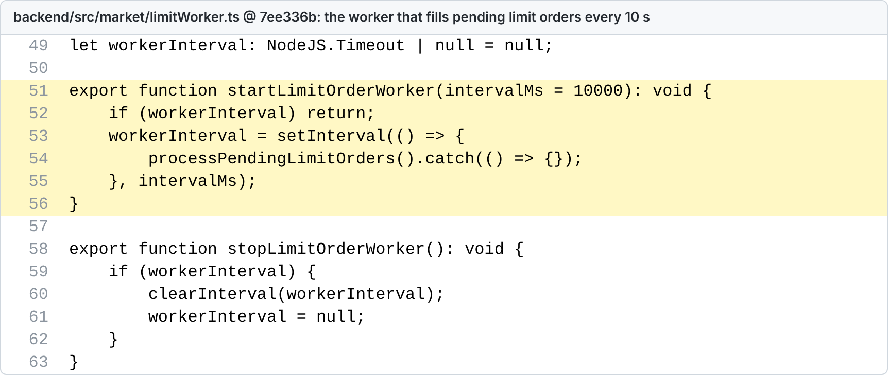
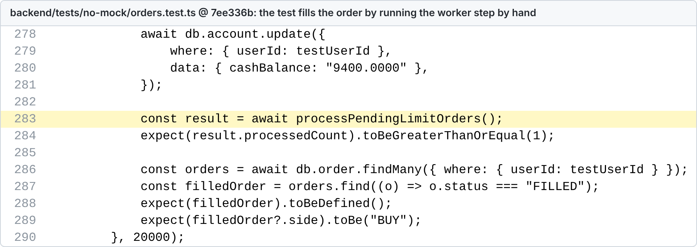

# Code Review

## 1. Change History

| **Change Date**   | **Modified Sections** | **Rationale** |
| ----------------- | --------------------- | ------------- |
| 2026-11-04 | 2.1, 2.2, 2.3, 2.4 | Recorded the commit Codacy analysed and justified each issue it reports. |
| 2026-11-18 | 2.4 | Moved two "unsafe use of `any`" issues in `findNearbyPlaces` to their new lines after it started leaving out existing gems (commit `20b398c`); same false positive, same justification. |
| 2026-11-18 | 3.1, 3.2, 3.3 | Added the peer review we performed of TradeOff, the review we received from them, and the changes we made in response (including the fix for the concurrent-ratings fault they found). |

---

## 2. Automated Code Review Results

### 2.1. Commit Hash Where Codacy Ran

`7e2dd810ac358ab7b6e5164353eae6746b4630cb` (the head of `main`, after merging pull request #108 from `develop`, which Codacy analysed; the code Codacy checked is unchanged on `main`)

### 2.2. Unfixed Issues per Codacy Category

### 2.3. Unfixed Issues per Codacy Code Pattern

### 2.4. Justifications for Unfixed Issues

The 29 issues Codacy reports are listed below by code pattern. Most are false positives: Codacy runs ESLint without installing our dependencies, so it cannot see their types, and some security patterns match test code whose inputs are constants. The few that are real issues were not fixed because of time constraints, as noted.

- **Code Pattern: Unsafe use of `any` (no-unsafe-argument, no-unsafe-return, no-redundant-type-constituents)**

  1. **Issue**

     - **Location in Git:** [`backend/src/services/gemService.ts#L658`](https://github.com/ubc-cpen-321-excavator/excavator/blob/7e2dd810ac358ab7b6e5164353eae6746b4630cb/backend/src/services/gemService.ts#L658)
     - **Justification:** Codacy runs ESLint without installing our dependencies, so the types of `@googlemaps/places` cannot be resolved and everything derived from them becomes `any`. With the dependencies installed, `candidates` is typed `PlaceCandidate[]` (each built by `candidateFromGoogle`, which checks every field Google returns), and `namesIn` takes `string[]`. Our strict `tsc` type check (`npm run typecheck`, run in CI) passes with no `any`.

  2. **Issue**

     - **Location in Git:** [`backend/src/services/gemService.ts#L658`](https://github.com/ubc-cpen-321-excavator/excavator/blob/7e2dd810ac358ab7b6e5164353eae6746b4630cb/backend/src/services/gemService.ts#L658)
     - **Justification:** The same line, reported a second time as an unsafe return of the mapped names. Same reason: the type is only `any` because Codacy cannot load `@googlemaps/places`; with it, the value is `string[]`.

  3. **Issue**

     - **Location in Git:** [`backend/src/services/gemService.ts#L283`](https://github.com/ubc-cpen-321-excavator/excavator/blob/20b398c/backend/src/services/gemService.ts#L283)
     - **Justification:** Same cause, reported as an unsafe argument: `c.name` is a `string` once `@googlemaps/places` is resolved, so `namesIn(candidates.map(c => c.name))` gets the `string[]` it takes. This replaces the issue Codacy reported at the old line 660, which moved when `GET /place/nearby` started leaving out existing gems (pull request #124).

  4. **Issue**

     - **Location in Git:** [`backend/src/services/gemService.ts#L285`](https://github.com/ubc-cpen-321-excavator/excavator/blob/20b398c/backend/src/services/gemService.ts#L285)
     - **Justification:** Same cause, reported as an "error typed" return: `candidates.filter(...)` is `PlaceCandidate[]` when the dependency types load, matching the method's declared return type, and `tsc` checks it. This replaces the issue Codacy reported at the old line 660 (pull request #124).

  5. **Issue**

     - **Location in Git:** [`backend/src/services/authService.ts#L195`](https://github.com/ubc-cpen-321-excavator/excavator/blob/7e2dd810ac358ab7b6e5164353eae6746b4630cb/backend/src/services/authService.ts#L195)
     - **Justification:** Codacy cannot load the `google-auth-library` types, so `payload.sub` looks like `any`. It is typed `string` in the library, and line 185 already rejects a payload without `sub`, so a non-empty string is always passed. The Google name fields, which really are untyped, are read as `unknown` and checked with `nonEmpty`.

  6. **Issue**

     - **Location in Git:** [`backend/tests/helpers/db.ts#L21`](https://github.com/ubc-cpen-321-excavator/excavator/blob/7e2dd810ac358ab7b6e5164353eae6746b4630cb/backend/tests/helpers/db.ts#L21)
     - **Justification:** Test helper. `MongoMemoryServer` is only seen as `any` because Codacy does not install `mongodb-memory-server`; with it installed the union `MongoMemoryServer | undefined` is meaningful (undefined before `startDb` and after `stopDb`) and `tsc` accepts it.

  7. **Issue**

     - **Location in Git:** [`backend/tests/helpers/db.ts#L29`](https://github.com/ubc-cpen-321-excavator/excavator/blob/7e2dd810ac358ab7b6e5164353eae6746b4630cb/backend/tests/helpers/db.ts#L29)
     - **Justification:** Test helper, same cause: `getUri()` returns `string` in `mongodb-memory-server`, which Codacy does not load.

- **Code Pattern: NoSQL injection: untrusted input in `findOne()`**

  1. **Issue**

     - **Location in Git:** [`backend/tests/no-mock/profile.test.ts#L45`](https://github.com/ubc-cpen-321-excavator/excavator/blob/7e2dd810ac358ab7b6e5164353eae6746b4630cb/backend/tests/no-mock/profile.test.ts#L45)
     - **Justification:** False positive in a test. The query value is the constant `TEST_USER_ID` from `tests/helpers/auth.ts`, not user input, and the query runs against a throwaway in-memory MongoDB.

  2. **Issue**

     - **Location in Git:** [`backend/tests/no-mock/profile.test.ts#L51`](https://github.com/ubc-cpen-321-excavator/excavator/blob/7e2dd810ac358ab7b6e5164353eae6746b4630cb/backend/tests/no-mock/profile.test.ts#L51)
     - **Justification:** Same as above: the constant `TEST_USER_ID` in a test.

  3. **Issue**

     - **Location in Git:** [`backend/tests/no-mock/profile.test.ts#L64`](https://github.com/ubc-cpen-321-excavator/excavator/blob/7e2dd810ac358ab7b6e5164353eae6746b4630cb/backend/tests/no-mock/profile.test.ts#L64)
     - **Justification:** Same as above: the constant `TEST_USER_ID` in a test.

  4. **Issue**

     - **Location in Git:** [`backend/tests/no-mock/comment.test.ts#L23`](https://github.com/ubc-cpen-321-excavator/excavator/blob/7e2dd810ac358ab7b6e5164353eae6746b4630cb/backend/tests/no-mock/comment.test.ts#L23)
     - **Justification:** False positive in a test. This line only sends the test's own request; Codacy marks it as the "source" for the query on line 27.

  5. **Issue**

     - **Location in Git:** [`backend/tests/no-mock/comment.test.ts#L27`](https://github.com/ubc-cpen-321-excavator/excavator/blob/7e2dd810ac358ab7b6e5164353eae6746b4630cb/backend/tests/no-mock/comment.test.ts#L27)
     - **Justification:** False positive in a test. `response.body.id` is the comment ID our own server returned to the test a line earlier, used to check that the comment was stored; no outside input reaches the query. In the production code, every value used in a query is validated first (for example, place IDs must match `places/<id>`).

- **Code Pattern: "This looks like a JavaScript template string" (no-template-curly-in-string)**

  1. **Issue**

     - **Location in Git:** [`backend/tests/helpers/auth.ts#L18`](https://github.com/ubc-cpen-321-excavator/excavator/blob/7e2dd810ac358ab7b6e5164353eae6746b4630cb/backend/tests/helpers/auth.ts#L18)
     - **Justification:** False positive. This rule is for `${...}` written inside ordinary quotes by mistake; here it is a real template literal (backticks) that builds the `Authorization: Bearer <token>` header for tests, and it produces the intended value.

  2. **Issue**

     - **Location in Git:** [`backend/tests/no-mock/auth.test.ts#L67`](https://github.com/ubc-cpen-321-excavator/excavator/blob/7e2dd810ac358ab7b6e5164353eae6746b4630cb/backend/tests/no-mock/auth.test.ts#L67)
     - **Justification:** Same false positive: a real template literal that builds a test's `Authorization` header.

  3. **Issue**

     - **Location in Git:** [`backend/tests/no-mock/auth.test.ts#L78`](https://github.com/ubc-cpen-321-excavator/excavator/blob/7e2dd810ac358ab7b6e5164353eae6746b4630cb/backend/tests/no-mock/auth.test.ts#L78)
     - **Justification:** Same false positive: a real template literal that builds a test's `Authorization` header.

- **Code Pattern: Open redirect: untrusted input in `redirect()`**

  1. **Issue**

     - **Location in Git:** [`backend/src/controllers/gemController.ts#L104`](https://github.com/ubc-cpen-321-excavator/excavator/blob/7e2dd810ac358ab7b6e5164353eae6746b4630cb/backend/src/controllers/gemController.ts#L104)
     - **Justification:** False positive. This is not a redirect: it sets the `Location` header of a `201 Created` response to the new Gem's own path on our API, as HTTP recommends, and clients do not follow it. The value is built by the server: the path is fixed and `gem.name` is a validated Google place ID (`places/<id>`), additionally passed through `encodeURIComponent`, so it cannot point to another site.

- **Code Pattern: Comment on a private property or function instead of a self-explanatory name**

  1. **Issue**

     - **Location in Git:** [`utils/location/LocationSettingsPrompt.kt#L163`](https://github.com/ubc-cpen-321-excavator/excavator/blob/7e2dd810ac358ab7b6e5164353eae6746b4630cb/frontend/app/src/main/java/com/example/cpen321application/utils/location/LocationSettingsPrompt.kt#L163)
     - **Justification:** The name already says what it is (the location-settings request). The comment explains *why* balanced priority is used instead of high accuracy, which a name cannot carry, so we kept it.

  2. **Issue**

     - **Location in Git:** [`presentation/viewmodels/GemViewModel.kt#L74`](https://github.com/ubc-cpen-321-excavator/excavator/blob/7e2dd810ac358ab7b6e5164353eae6746b4630cb/frontend/app/src/main/java/com/example/cpen321application/presentation/viewmodels/GemViewModel.kt#L74)
     - **Justification:** The name says what it is; the comment adds that live updates wait for this flag, which explains how the class works, not what the property is.

  3. **Issue**

     - **Location in Git:** [`presentation/viewmodels/GemViewModel.kt#L196`](https://github.com/ubc-cpen-321-excavator/excavator/blob/7e2dd810ac358ab7b6e5164353eae6746b4630cb/frontend/app/src/main/java/com/example/cpen321application/presentation/viewmodels/GemViewModel.kt#L196)
     - **Justification:** The name describes the function; the comment explains the design choice (the feed runs only while the screen observes it, with a grace period across configuration changes).

  4. **Issue**

     - **Location in Git:** [`presentation/viewmodels/GemViewModel.kt#L208`](https://github.com/ubc-cpen-321-excavator/excavator/blob/7e2dd810ac358ab7b6e5164353eae6746b4630cb/frontend/app/src/main/java/com/example/cpen321application/presentation/viewmodels/GemViewModel.kt#L208)
     - **Justification:** The name describes the function; the comment explains its lifecycle (it suspends while live, and cancelling it closes the socket), which a name cannot express.

  5. **Issue**

     - **Location in Git:** [`presentation/viewmodels/GemViewModel.kt#L253`](https://github.com/ubc-cpen-321-excavator/excavator/blob/7e2dd810ac358ab7b6e5164353eae6746b4630cb/frontend/app/src/main/java/com/example/cpen321application/presentation/viewmodels/GemViewModel.kt#L253)
     - **Justification:** The name says what it checks; the comment explains why comparing `placesName` is enough (it is the Gem's primary key).

  6. **Issue**

     - **Location in Git:** [`data/remote/websocket/DashboardLiveUpdatesClient.kt#L46`](https://github.com/ubc-cpen-321-excavator/excavator/blob/7e2dd810ac358ab7b6e5164353eae6746b4630cb/frontend/app/src/main/java/com/example/cpen321application/data/remote/websocket/DashboardLiveUpdatesClient.kt#L46)
     - **Justification:** The name says what it stores; the comment explains why it is kept (the server forgets the subscription when the socket closes, so it is re-sent on reconnect).

  7. **Issue**

     - **Location in Git:** [`data/remote/websocket/DashboardLiveUpdatesClient.kt#L119`](https://github.com/ubc-cpen-321-excavator/excavator/blob/7e2dd810ac358ab7b6e5164353eae6746b4630cb/frontend/app/src/main/java/com/example/cpen321application/data/remote/websocket/DashboardLiveUpdatesClient.kt#L119)
     - **Justification:** The name says what it checks; the comment explains why the check is needed at all (Gson ignores Kotlin nullability, so "non-null" fields can be null at runtime).

  8. **Issue**

     - **Location in Git:** [`data/remote/websocket/DashboardLiveUpdatesClient.kt#L149`](https://github.com/ubc-cpen-321-excavator/excavator/blob/7e2dd810ac358ab7b6e5164353eae6746b4630cb/frontend/app/src/main/java/com/example/cpen321application/data/remote/websocket/DashboardLiveUpdatesClient.kt#L149)
     - **Justification:** The name says what it does; the comment explains the thread-safety reason (callbacks from an old socket must be ignored).

- **Code Pattern: Caught exception is too generic**

  1. **Issue**

     - **Location in Git:** [`data/remote/websocket/DashboardLiveUpdatesClient.kt#L112`](https://github.com/ubc-cpen-321-excavator/excavator/blob/7e2dd810ac358ab7b6e5164353eae6746b4630cb/frontend/app/src/main/java/com/example/cpen321application/data/remote/websocket/DashboardLiveUpdatesClient.kt#L112)
     - **Justification:** Deliberate. This parses messages from the network, and a malformed message can throw several unrelated exceptions (`JsonSyntaxException`, `IllegalStateException`, `UnsupportedOperationException`, `ClassCastException`, `NullPointerException`). Any of them means the same thing: drop the message, log it, and keep the live feed running, instead of crashing the socket listener.

- **Code Pattern: Thrown exception is too generic**

  1. **Issue**

     - **Location in Git:** [`data/repositories/CommentRepositoryImpl.kt#L27`](https://github.com/ubc-cpen-321-excavator/excavator/blob/7e2dd810ac358ab7b6e5164353eae6746b4630cb/frontend/app/src/main/java/com/example/cpen321application/data/repositories/CommentRepositoryImpl.kt#L27)
     - **Justification:** Not fixed because of time constraints. The code already has a TODO to replace it with a specific error type that carries the HTTP status.

  2. **Issue**

     - **Location in Git:** [`data/repositories/GemRepositoryImpl.kt#L44`](https://github.com/ubc-cpen-321-excavator/excavator/blob/7e2dd810ac358ab7b6e5164353eae6746b4630cb/frontend/app/src/main/java/com/example/cpen321application/data/repositories/GemRepositoryImpl.kt#L44)
     - **Justification:** Not fixed because of time constraints. Same TODO as above.

- **Code Pattern: Function is too long**

  1. **Issue**

     - **Location in Git:** [`presentation/activities/dashboard/DashboardActivity.kt#L39`](https://github.com/ubc-cpen-321-excavator/excavator/blob/7e2dd810ac358ab7b6e5164353eae6746b4630cb/frontend/app/src/main/java/com/example/cpen321application/presentation/activities/dashboard/DashboardActivity.kt#L39)
     - **Justification:** Not fixed because of time constraints. `onCreate` is 71 lines against a limit of 60; most of it is the location permission and location-off dialogs, which could be moved into their own composable.

- **Code Pattern: Labeled expressions increase complexity**

  1. **Issue**

     - **Location in Git:** [`presentation/activities/discovery/composables/DiscoveryMap.kt#L126`](https://github.com/ubc-cpen-321-excavator/excavator/blob/7e2dd810ac358ab7b6e5164353eae6746b4630cb/frontend/app/src/main/java/com/example/cpen321application/presentation/activities/discovery/composables/DiscoveryMap.kt#L126)
     - **Justification:** `return@LaunchedEffect` is the standard Kotlin way to leave a lambda early when there is no location yet. Removing the label means wrapping the rest of the effect in an `if` or `let`, which adds nesting instead of reducing it.

---

## 3. Manual Code Review Results

### 3.1. Review You Performed

- **Peer group reviewed:** TradeOff ([`juliselormey/cpen321-TradeOff`](https://github.com/juliselormey/cpen321-TradeOff))
- **Commit SHA reviewed:** `7ee336bea9c67146034e78bde72eb18ff6143139` (`main`, Nov 10, 2026), with their `CP2_TradeOff.apk`
- **Date the artifacts were exchanged:** [WRITE_HERE]
- **Review report submitted:** [`CP3_TradeOff_Review.pdf`](res/CP3_TradeOff_Review.pdf)

We read their back end (Express, Prisma and MySQL) and Android front end, ran their back-end Jest suite from a fresh clone with coverage, and compared their tests and Codacy results against their documents.

| **Section**          | **Item**                                                                                                                                             | **Score** |
| -------------------- | ---------------------------------------------------------------------------------------------------------------------------------------------------- | --------- |
| Manual code review   | Code is maintainable (well-documented, uses self-explanatory variable names, does not have complicated and long methods, magic numbers, etc.), efficient, handles error cases well | 6/10      |
| Manual test review   | Tests are complete (all APIs exposed to the front-end are tested, three main features are tested), errors and edge cases are thoroughly tested, correct assertions are used | 6/10      |
| Manual test review   | Test code is maintainable and well-structured                                                                                                          | 7/10      |
| Manual test review   | Test implementation matches the requirements and design                                                                                                | 5/10      |
| Manual test review   | Non-functional requirements are tested well                                                                                                            | 1/10      |
| Manual test review   | Tests achieve high coverage and cases of < 100% coverage are well-justified                                                                            | 3/10      |
| Manual test review   | All back-end tests can be run automatically                                                                                                            | 2/10      |
| Automated code review| Codacy runs with the required setup                                                                                                                    | 7/10      |
| Automated code review| All remaining Codacy issues are well-justified                                                                                                          | 2/10      |

**Major fault reported**

- **Description:** Pending limit orders never execute. A limit order ("buy only if the price drops to $X", or "sell only if it rises to $X") is checked against the price once, when it is placed ([`routes/trades.ts#L171`](https://github.com/juliselormey/cpen321-TradeOff/blob/7ee336bea9c67146034e78bde72eb18ff6143139/backend/src/routes/trades.ts#L171)); if the price is not there yet, it is saved as Pending and, for a buy, its cash is set aside. The background job that is meant to fill pending orders every 10 seconds, `startLimitOrderWorker` ([`market/limitWorker.ts#L51`](https://github.com/juliselormey/cpen321-TradeOff/blob/7ee336bea9c67146034e78bde72eb18ff6143139/backend/src/market/limitWorker.ts#L51)), is never started: the server's startup file ([`index.ts`](https://github.com/juliselormey/cpen321-TradeOff/blob/7ee336bea9c67146034e78bde72eb18ff6143139/backend/src/index.ts)) only starts the HTTPS server. So a pending order stays Pending forever, even after the price passes the limit, and its cash stays locked until the user cancels it by hand. Their tests miss it because the order test runs the job by hand ([`tests/no-mock/orders.test.ts#L283`](https://github.com/juliselormey/cpen321-TradeOff/blob/7ee336bea9c67146034e78bde72eb18ff6143139/backend/tests/no-mock/orders.test.ts#L283)). A second symptom: the Portfolio screen leaves the set-aside cash out of the user's net worth while the Leaderboard counts it, so the same user is worth $9,000 on one and $10,000 on the other while a $1,000 limit buy is pending.
- **Steps to reproduce:**
  1. Sign in and place a limit buy order for a stock with a limit just below its current price, so it does not fill right away. The order appears as Pending and its cash is set aside.
  2. Wait until the stock's price drops below the limit (or, in a test, set the price below the limit).
  3. The order is still Pending after any amount of time, because nothing on the server ever checks it again. The same applies to limit sells.
  4. Searching the code at the reviewed commit confirms it: `startLimitOrderWorker` is defined but never called.
- **Screenshots:**

  

  

  

  
- **Severity:** High. Limit orders are part of TradeOff's own main use case 2 (Buy Stocks), which promises that a pending order "can be completed or cancelled later"; in practice it can only be cancelled, and the user's cash stays locked until then.

### 3.2. Review You Received

- **Reviewing group:** TradeOff
- **Commit SHA that was reviewed:** `a5517413ec51e5eafc0b7b469840a4a5b143b3a7` (`main`, Nov 4, 2026); review dated Nov 17, 2026
- **Review report received:** [`CP3_Excavator_Review.pdf`](res/CP3_Excavator_Review.pdf)

| **Section**          | **Item**                                                                                                                                             | **Score** |
| -------------------- | ---------------------------------------------------------------------------------------------------------------------------------------------------- | --------- |
| Manual code review   | Code is maintainable, efficient, handles error cases well                                                                                               | 7/10      |
| Manual test review   | Tests are complete, errors and edge cases are thoroughly tested, correct assertions are used                                                            | 9/10      |
| Manual test review   | Test code is maintainable and well-structured                                                                                                          | 10/10     |
| Manual test review   | Test implementation matches the requirements and design                                                                                                | 8/10      |
| Manual test review   | Non-functional requirements are tested well                                                                                                            | 8/10      |
| Manual test review   | Tests achieve high coverage and cases of < 100% coverage are well-justified                                                                            | 9/10      |
| Manual test review   | All back-end tests can be run automatically                                                                                                            | 10/10     |
| Automated code review| Codacy runs with the required setup                                                                                                                    | 10/10     |
| Automated code review| All remaining Codacy issues are well-justified                                                                                                          | 10/10     |

**Major fault reported against your project**

- **Description:** Concurrent rating submissions can overwrite the correct Gem Score. When two users rate the same gem at the same time, both requests return 200, but the gem can end up with the totals of the request that finished last instead of the newest ones. In their reproduction, user A rates 5 stars and user B rates 1 star; the gem should have 2 ratings, an average of 3 and a Gem Score of 66, but it was left with 1 rating, an average of 5 and a Gem Score of 68.4. The cause was that saving a rating, recounting the gem's ratings and saving the new totals were separate steps, and nothing stopped an older recount from overwriting a newer one.
- **Severity:** High: the request reports success while the stored Gem Score is wrong, and the Gem Score is central to the app.

### 3.3. Actions Taken in Response to the Review

| **Finding** | **Action Taken** | **Commit / Location in Git** |
| ----------- | ---------------- | ---------------------------- |
| Major fault: concurrent ratings can overwrite the correct Gem Score | Each rating now takes a sequence number on the gem (an atomic increment) after it is stored and before the recount. A recount's totals are only saved if no rating with a later number has saved its totals already, and a later number's recount always includes the earlier rating, so the newest totals always win. Added their scenario as a regression test that sends two ratings at once against a real database. | `fe53336` (PR #125): [`backend/src/services/ratingService.ts#L68`](../backend/src/services/ratingService.ts#L68), [`backend/tests/no-mock/rating.test.ts#L51`](../backend/tests/no-mock/rating.test.ts#L51) |
| `gemService.ts` has too many responsibilities (about 900 lines: Gem and Place, Google Places details and app rules in one file) | Split it into five files, each with one responsibility: Gem and Place with the naming rules, the errors, the Google Places mapping, the database repository, and the service itself. No behaviour changed; all tests pass unchanged. | `602514e` (PR #122): [`backend/src/services/`](../backend/src/services/) (`gem.ts`, `gemErrors.ts`, `googlePlaces.ts`, `gemRepo.ts`, `gemService.ts`) |
| `GemRepositoryImpl.kt`: `addGem` throws a generic exception that discards the HTTP status and error body (the TODO at line 85) | The repositories now go through a shared error-handling call that returns the result or the server's error, instead of throwing `Exception("Non 200 Response")`. | `1c299e8` (PR #111): [`GemRepositoryImpl.kt`](../frontend/app/src/main/java/com/example/cpen321application/data/repositories/GemRepositoryImpl.kt), [`Resource.kt`](../frontend/app/src/main/java/com/example/cpen321application/data/repositories/Resource.kt) |
| `GemViewModel.kt` line 131: `getGemCandidates` is never called | It is now called when the user opens the list of nearby places to add as a gem, with the type filters they selected. | PR #118: [`NearbyGemsOptionsList.kt#L28`](../frontend/app/src/main/java/com/example/cpen321application/presentation/activities/discovery/composables/gemcreationsheet/nearbygemcandidates/NearbyGemsOptionsList.kt#L28) |
| `MainActivity.kt` contains a lot of commented-out code | Removed the file in the front-end refactor; its screens now live in their own activities. | `ae52653` (PR #111) |
| `Testing.md`: the front-end test steps are the course template ("buy milk") and match nothing in Excavator | Wrote end-to-end tests of our main features (Add a Gem, Make comments, Favorites), and section 4 of `Testing.md` now describes them in place of the template. | `5d21d17` (branch `Frontend-tests`): [`frontend/app/src/androidTest/e2e/`](../frontend/app/src/androidTest/e2e/); [`Testing.md`, section 4](Testing.md#4-front-end-test-specification) |

- **Findings not acted on.** For each finding you decided not to address, give the reason:
  1. **Finding:** `GemRepositoryImpl.kt` line 49: the argument of `getNewestGems` has no effect; it produces the same API request.
     - **Justification:** Correct, but it does not change what the app does: the app's only caller ([`GemViewModel.kt#L100`](../frontend/app/src/main/java/com/example/cpen321application/presentation/viewmodels/GemViewModel.kt#L100)) passes no number, so the request is always the same, and the server answers with its default of the 20 newest gems, which the dashboard shows. We will remove the unused parameter in the final release.
  2. **Finding:** The requirements say an expired login sends the user back to the sign-in screen, but the tests only check that the server rejects the request.
     - **Justification:** The server's side is tested: every interface that needs a login has tests that an invalid or expired token is answered with 401 (see `Testing.md`, section 2.1). The front-end part cannot be tested end to end within the course's rules: front-end tests must start already signed in with the TA's own account and must not mock the back end (Project Description, section 9), so a test has no way to make that account's login expire.
  3. **Finding:** The non-functional requirement tests measure how fast the server sends updates, but do not check that the updates appear on the screen.
     - **Justification:** Our requirement is that an update reaches every user in range within 1 second ([Requirements_and_Design.md, section 3.7](Requirements_and_Design.md#37-non-functional-requirements)). The test measures exactly that, at 250 real WebSocket clients connected the same way the app is, from the moment the request is sent until each client receives the update. Drawing the update on the screen is the Android UI's work and is not part of the requirement.
