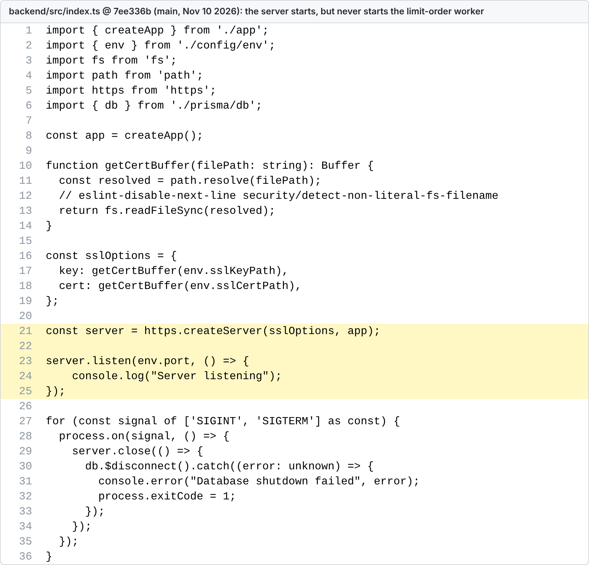
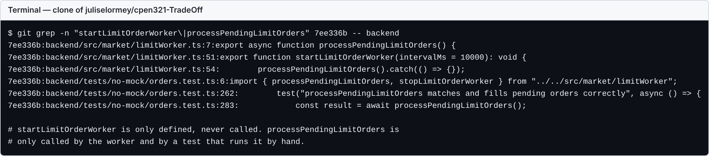

# Code Review

## 1. Change History

| **Change Date**   | **Modified Sections** | **Rationale** |
| ----------------- | --------------------- | ------------- |
| 2026-11-04 | 2.1, 2.2, 2.3, 2.4 | Recorded the commit Codacy analysed and justified each issue it reports. |
| 2026-11-18 | 2.4 | Moved two "unsafe use of `any`" issues in `findNearbyPlaces` to their new lines after it started leaving out existing gems (commit `20b398c`); same false positive, same justification. |
| 2026-11-18 | 3.1, 3.2, 3.3 | Added the peer review we performed of TradeOff, the review we received from them, and the changes we made in response (including the fix for the concurrent-ratings fault they found). |
| 2026-11-18 | 2.1, 2.2, 2.3, 2.4 | Codacy now runs only detekt, ESLint and Trivy, as the course requires. Fixed two detekt issues (an empty default constructor and a catch that was more general than needed) and rewrote the justification of every remaining issue with sources. |

---

## 2. Automated Code Review Results

### 2.1. Commit Hash Where Codacy Ran

`[MAIN COMMIT SHA AFTER THE FINAL MERGE]`

### 2.2. Unfixed Issues per Codacy Category

### 2.3. Unfixed Issues per Codacy Code Pattern

### 2.4. Justifications for Unfixed Issues

Codacy runs only the three tools the course requires, **detekt** (Kotlin), **ESLint** (TypeScript) and **Trivy**, with the repository's unchanged `detekt.yml` and `.eslintrc.json` (Project Description, section 7). Trivy reports no issues. Every other issue was fixed; the ones left are listed below by code pattern.

- **Code Pattern: Disallow Unsafe Argument Usage (`@typescript-eslint/no-unsafe-argument`), Disallow Unsafe Return of Any Type (`@typescript-eslint/no-unsafe-return`) and `@typescript-eslint/no-redundant-type-constituents`**

  These eight issues are false positives caused by how Codacy runs ESLint, not by our code. All three rules use TypeScript's type information, and they report a value only when its type is `any`. Codacy runs ESLint on the repository without installing our dependencies, so the type declarations of four libraries we use (`@googlemaps/places`, `google-auth-library`, `mongodb-memory-server` and `supertest`) are missing, and TypeScript gives every value that comes from them the type `any`. typescript-eslint documents exactly this behaviour: *"if a type is declared in another file but that file is not included, the type will become `any`, and cause our `no-unsafe-*` rules to report"* ([typescript-eslint, "Typed Linting" troubleshooting](https://typescript-eslint.io/troubleshooting/typed-linting/)). The rules themselves only report values of type `any` ([no-unsafe-argument](https://typescript-eslint.io/rules/no-unsafe-argument), [no-unsafe-return](https://typescript-eslint.io/rules/no-unsafe-return)).

  We verified this two ways. First, our TypeScript type check (`npm run typecheck`, with `"strict": true` in `backend/tsconfig.json`, run by GitHub Actions on every push to `main`) passes, and in strict mode TypeScript rejects any implicit `any`. Second, we ran the same three ESLint rules, with type information, on the same code: with our dependencies installed they report **0** issues; with only the four libraries' type declarations removed, they report exactly these 8 issues on the same lines. With the declarations available, each value has the type given below.

  1. **Issue**

     - **Location in Git:** [`backend/src/services/authService.ts#L195`](../backend/src/services/authService.ts#L195) (unsafe argument)
     - **Justification:** `payload.sub` is declared as `sub: string` in `google-auth-library`'s `TokenPayload`, and line 184 already rejects a payload without it, so a non-empty string is always passed to `new User(...)`. It only looks like `any` because Codacy cannot load `google-auth-library`'s types.

  2. **Issue**

     - **Location in Git:** [`backend/src/services/gemService.ts#L309`](../backend/src/services/gemService.ts#L309) (unsafe argument, and unsafe return)
     - **Justification:** `candidates` is the list of `PlaceCandidate` objects built by `candidateFromGoogle` from the `@googlemaps/places` search response, so `candidates.map(c => c.name)` is a `string[]`, which is what `namesIn(names: string[])` takes. Both reports on this line come from the response type of `@googlemaps/places`, which Codacy cannot load.

  3. **Issue**

     - **Location in Git:** [`backend/src/services/gemService.ts#L311`](../backend/src/services/gemService.ts#L311) (unsafe argument, and unsafe return of an "error typed" value)
     - **Justification:** Same cause: `candidates.filter(c => !gems.has(c.name))` returns a `PlaceCandidate[]`, and `c.name` is a `string`; `gems` is a `Set<string>`. typescript-eslint calls a type it could not resolve an "error typed" value, which is reported the same way as `any` ([typescript-eslint, "Typed Linting" troubleshooting](https://typescript-eslint.io/troubleshooting/typed-linting/)).

  4. **Issue**

     - **Location in Git:** [`backend/tests/helpers/db.ts#L21`](../backend/tests/helpers/db.ts#L21) (redundant type constituent)
     - **Justification:** Test helper. `MongoMemoryServer | undefined` is a real union (`undefined` before `startDb` and after `stopDb`); the rule reports it only because `MongoMemoryServer`, from `mongodb-memory-server`, becomes `any` without its type declarations, and `any` absorbs the rest of a union.

  5. **Issue**

     - **Location in Git:** [`backend/tests/helpers/db.ts#L29`](../backend/tests/helpers/db.ts#L29) (unsafe argument)
     - **Justification:** Test helper. `MongoMemoryServer.getUri()` is declared to return a `string` in `mongodb-memory-server`, which is what `mongoose.connect` takes.

  6. **Issue**

     - **Location in Git:** [`backend/tests/no-mock/rating.test.ts#L66`](../backend/tests/no-mock/rating.test.ts#L66) (unsafe return)
     - **Justification:** Test code. `.then(response => response)` returns `supertest`'s `Response` object unchanged; it is written this way so the first request is sent right away, while the second one is sent during the test's pause. It only looks like `any` because Codacy cannot load `supertest`'s types.

- **Code Pattern: Avoid Comments for Private Functions (detekt `CommentOverPrivateFunction`) and Avoid Comments Over Private Properties by Using Self-Explanatory Names (detekt `CommentOverPrivateProperty`)**

  detekt's documentation explains that these rules report a comment on a private function or property because *"it probably explains the functionality"*, which could mean the name is not self-explanatory, and lists both rules as **not active by default** ([detekt, Comments rule set](https://detekt.dev/docs/rules/comments), `DocumentationOverPrivateFunction` and `DocumentationOverPrivateProperty`). The comments below do not explain *what* the function or property does: each one's name already says that. They record *why* it exists or a constraint a name cannot carry, such as thread safety, a library's behaviour or a lifecycle rule, which is information no name could hold.

  1. **Issue**

     - **Location in Git:** [`DashboardLiveUpdatesClient.kt#L118`](../frontend/app/src/main/java/com/example/cpen321application/data/remote/websocket/DashboardLiveUpdatesClient.kt#L118) (`isComplete`)
     - **Justification:** The comment explains why the check is needed at all: Gson ignores Kotlin's nullability, so fields declared non-null can still be null at runtime.

  2. **Issue**

     - **Location in Git:** [`DashboardLiveUpdatesClient.kt#L148`](../frontend/app/src/main/java/com/example/cpen321application/data/remote/websocket/DashboardLiveUpdatesClient.kt#L148) (`clearIfCurrent`)
     - **Justification:** The comment records a thread-safety rule: callbacks from an old socket must not clear the current one.

  3. **Issue**

     - **Location in Git:** [`GemViewModel.kt#L278`](../frontend/app/src/main/java/com/example/cpen321application/presentation/viewmodels/GemViewModel.kt#L278) (`observeLiveUpdates`)
     - **Justification:** The comment explains a design choice: the live feed only runs while a screen observes it, with a grace period so a configuration change does not reconnect it.

  4. **Issue**

     - **Location in Git:** [`GemViewModel.kt#L290`](../frontend/app/src/main/java/com/example/cpen321application/presentation/viewmodels/GemViewModel.kt#L290) (`runLiveUpdates`)
     - **Justification:** The comment explains the function's lifecycle: it suspends while the feed is live, and cancelling it closes the socket.

  5. **Issue**

     - **Location in Git:** [`GemViewModel.kt#L337`](../frontend/app/src/main/java/com/example/cpen321application/presentation/viewmodels/GemViewModel.kt#L337) (`sameGemAs`)
     - **Justification:** The comment explains why comparing `placesName` is enough: it is the gem's primary key.

  6. **Issue**

     - **Location in Git:** [`DashboardLiveUpdatesClient.kt#L45`](../frontend/app/src/main/java/com/example/cpen321application/data/remote/websocket/DashboardLiveUpdatesClient.kt#L45) (`subscription`)
     - **Justification:** The comment explains why the subscription is kept: the server forgets it when the socket closes, so it is sent again on every reconnect.

  7. **Issue**

     - **Location in Git:** [`GemViewModel.kt#L77`](../frontend/app/src/main/java/com/example/cpen321application/presentation/viewmodels/GemViewModel.kt#L77) (`_newestLoaded`)
     - **Justification:** The comment records an ordering rule: live updates wait until the first full load of the newest gems has arrived.

  8. **Issue**

     - **Location in Git:** [`LocationSettingsPrompt.kt#L163`](../frontend/app/src/main/java/com/example/cpen321application/utils/location/LocationSettingsPrompt.kt#L163) (`SETTINGS_REQUEST`)
     - **Justification:** The comment explains why balanced priority is used rather than high accuracy: high accuracy would also prompt the user about GPS modes the app does not need.

- **Code Pattern: Avoid Catching Too Generic Exceptions (detekt `TooGenericExceptionCaught`)**

  1. **Issue**

     - **Location in Git:** [`DashboardLiveUpdatesClient.kt#L111`](../frontend/app/src/main/java/com/example/cpen321application/data/remote/websocket/DashboardLiveUpdatesClient.kt#L111) (`parseEvent`)
     - **Justification:** This parses messages that arrive from the network, and a malformed message can fail in several unrelated ways: Gson's `JsonParser.parseString` throws `JsonParseException` or `JsonSyntaxException` for invalid JSON ([Gson Javadoc, `JsonParser`](https://javadoc.io/static/com.google.code.gson/gson/2.10.1/com.google.gson/com/google/gson/JsonParser.html)), and reading a field of the wrong type or a missing field throws other runtime exceptions. All of them mean the same thing, a message we cannot use, and the code handles them the same way: it logs the message and drops it, so one bad message cannot stop the live feed. Listing each exception separately would repeat the same handling.

  2. **Issue**

     - **Location in Git:** [`BaseRemoteRepo.kt#L57`](../frontend/app/src/main/java/com/example/cpen321application/data/repositories/BaseRemoteRepo.kt#L57) (`callAndCatch`)
     - **Justification:** This is the last of three handlers around every request the app makes: network failures (`IOException`) and HTTP errors (`HttpException`) are caught specifically just above, and this one turns anything unexpected (for example a response the mapper cannot convert) into an error the screen shows, instead of crashing the app. It does not stop coroutine cancellation from propagating: the call runs inside `withContext(Dispatchers.IO)`, which has a *"prompt cancellation guarantee"*: if the caller was cancelled, it *"discards the result of withContext and throws a CancellationException"* ([kotlinx.coroutines, `withContext`](https://kotlinlang.org/api/kotlinx.coroutines/kotlinx-coroutines-core/kotlinx.coroutines/with-context.html)).

- **Code Pattern: Labeled expressions (detekt `LabeledExpression`)**

  1. **Issue**

     - **Location in Git:** [`DiscoveryMap.kt#L135`](../frontend/app/src/main/java/com/example/cpen321application/presentation/activities/discovery/composables/DiscoveryMap.kt#L135)
     - **Justification:** `return@LaunchedEffect` leaves the effect early while the user's location is not known yet. Returning to the label of the lambda is the way Kotlin's documentation gives for returning from a lambda, *"label it and qualify the `return`"*, with implicit labels named after the function the lambda is passed to ([Kotlin, Returns and jumps](https://kotlinlang.org/docs/returns.html), "Return to labels"). Without the label, the rest of the effect would have to be nested inside an `if`, which is the extra complexity the rule is meant to prevent.

- **Code Pattern: Long parameter list (detekt `LongParameterList`)**

  1. **Issue**

     - **Location in Git:** [`GemViewModel.kt#L52`](../frontend/app/src/main/java/com/example/cpen321application/presentation/viewmodels/GemViewModel.kt#L52) (`GemViewModel` constructor)
     - **Justification:** The constructor is never called by our code: it is annotated `@Inject` and Hilt creates the view model, passing each parameter itself ([Android, Dependency injection with Hilt](https://developer.android.com/training/dependency-injection/hilt-android)). Its parameters are one use case per action of the screen (load nearby gems, load the newest gems, add a gem, list the places to add, and three for favorites), the live feed client and a mapper. Grouping them into a holder object would only hide the same dependencies behind another class.

---

## 3. Manual Code Review Results

### 3.1. Review You Performed

- **Peer group reviewed:** TradeOff ([`juliselormey/cpen321-TradeOff`](https://github.com/juliselormey/cpen321-TradeOff))
- **Commit SHA reviewed:** `7ee336bea9c67146034e78bde72eb18ff6143139` (`main`, Nov 10, 2026), with their `CP2_TradeOff.apk`
- **Date the artifacts were exchanged:** November 18, 2026
- **Review report submitted:** [`CP3_TradeOff_Review.pdf`](res/CP3_TradeOff_Review.pdf)

We read their back end (Express, Prisma and MySQL) and Android front end, ran their back-end Jest suite from a fresh clone with coverage, and compared their tests and Codacy results against their documents.

| **Section**          | **Item**                                                                                                                                             | **Score** |
| -------------------- | ---------------------------------------------------------------------------------------------------------------------------------------------------- | --------- |
| Manual code review   | Code is maintainable (well-documented, uses self-explanatory variable names, does not have complicated and long methods, magic numbers, etc.), efficient, handles error cases well | 6/10      |
| Manual test review   | Tests are complete (all APIs exposed to the front-end are tested, three main features are tested), errors and edge cases are thoroughly tested, correct assertions are used | 6/10      |
| Manual test review   | Test code is maintainable and well-structured                                                                                                          | 7/10      |
| Manual test review   | Test implementation matches the requirements and design                                                                                                | 5/10      |
| Manual test review   | Non-functional requirements are tested well                                                                                                            | 1/10      |
| Manual test review   | Tests achieve high coverage and cases of < 100% coverage are well-justified                                                                            | 3/10      |
| Manual test review   | All back-end tests can be run automatically                                                                                                            | 2/10      |
| Automated code review| Codacy runs with the required setup                                                                                                                    | 7/10      |
| Automated code review| All remaining Codacy issues are well-justified                                                                                                          | 2/10      |

**Major fault reported**

- **Description:** Pending limit orders never execute. A limit order ("buy only if the price drops to $X", or "sell only if it rises to $X") is checked against the price once, when it is placed ([`routes/trades.ts#L171`](https://github.com/juliselormey/cpen321-TradeOff/blob/7ee336bea9c67146034e78bde72eb18ff6143139/backend/src/routes/trades.ts#L171)); if the price is not there yet, it is saved as Pending and, for a buy, its cash is set aside. The background job that is meant to fill pending orders every 10 seconds, `startLimitOrderWorker` ([`market/limitWorker.ts#L51`](https://github.com/juliselormey/cpen321-TradeOff/blob/7ee336bea9c67146034e78bde72eb18ff6143139/backend/src/market/limitWorker.ts#L51)), is never started: the server's startup file ([`index.ts`](https://github.com/juliselormey/cpen321-TradeOff/blob/7ee336bea9c67146034e78bde72eb18ff6143139/backend/src/index.ts)) only starts the HTTPS server. So a pending order stays Pending forever, even after the price passes the limit, and its cash stays locked until the user cancels it by hand. Their tests miss it because the order test runs the job by hand ([`tests/no-mock/orders.test.ts#L283`](https://github.com/juliselormey/cpen321-TradeOff/blob/7ee336bea9c67146034e78bde72eb18ff6143139/backend/tests/no-mock/orders.test.ts#L283)). A second symptom: the Portfolio screen leaves the set-aside cash out of the user's net worth while the Leaderboard counts it, so the same user is worth $9,000 on one and $10,000 on the other while a $1,000 limit buy is pending.
- **Steps to reproduce:**
  1. Sign in and place a limit buy order for a stock with a limit just below its current price, so it does not fill right away. The order appears as Pending and its cash is set aside.
  2. Wait until the stock's price drops below the limit (or, in a test, set the price below the limit).
  3. The order is still Pending after any amount of time, because nothing on the server ever checks it again. The same applies to limit sells.
  4. Searching the code at the reviewed commit confirms it: `startLimitOrderWorker` is defined but never called.
- **Screenshots:**

  

  

  

  
- **Severity:** High. Limit orders are part of TradeOff's own main use case 2 (Buy Stocks), which promises that a pending order "can be completed or cancelled later"; in practice it can only be cancelled, and the user's cash stays locked until then.

### 3.2. Review You Received

- **Reviewing group:** TradeOff
- **Commit SHA that was reviewed:** `a5517413ec51e5eafc0b7b469840a4a5b143b3a7` (`main`, Nov 4, 2026); review dated Nov 17, 2026
- **Review report received:** [`CP3_Excavator_Review.pdf`](res/CP3_Excavator_Review.pdf)

| **Section**          | **Item**                                                                                                                                             | **Score** |
| -------------------- | ---------------------------------------------------------------------------------------------------------------------------------------------------- | --------- |
| Manual code review   | Code is maintainable, efficient, handles error cases well                                                                                               | 7/10      |
| Manual test review   | Tests are complete, errors and edge cases are thoroughly tested, correct assertions are used                                                            | 9/10      |
| Manual test review   | Test code is maintainable and well-structured                                                                                                          | 10/10     |
| Manual test review   | Test implementation matches the requirements and design                                                                                                | 8/10      |
| Manual test review   | Non-functional requirements are tested well                                                                                                            | 8/10      |
| Manual test review   | Tests achieve high coverage and cases of < 100% coverage are well-justified                                                                            | 9/10      |
| Manual test review   | All back-end tests can be run automatically                                                                                                            | 10/10     |
| Automated code review| Codacy runs with the required setup                                                                                                                    | 10/10     |
| Automated code review| All remaining Codacy issues are well-justified                                                                                                          | 10/10     |

**Major fault reported against your project**

- **Description:** Concurrent rating submissions can overwrite the correct Gem Score. When two users rate the same gem at the same time, both requests return 200, but the gem can end up with the totals of the request that finished last instead of the newest ones. In their reproduction, user A rates 5 stars and user B rates 1 star; the gem should have 2 ratings, an average of 3 and a Gem Score of 66, but it was left with 1 rating, an average of 5 and a Gem Score of 68.4. The cause was that saving a rating, recounting the gem's ratings and saving the new totals were separate steps, and nothing stopped an older recount from overwriting a newer one.
- **Severity:** High: the request reports success while the stored Gem Score is wrong, and the Gem Score is central to the app.

### 3.3. Actions Taken in Response to the Review

| **Finding** | **Action Taken** | **Commit / Location in Git** |
| ----------- | ---------------- | ---------------------------- |
| Major fault: concurrent ratings can overwrite the correct Gem Score | Each rating now takes a sequence number on the gem (an atomic increment) after it is stored and before the recount. A recount's totals are only saved if no rating with a later number has saved its totals already, and a later number's recount always includes the earlier rating, so the newest totals always win. Added their scenario as a regression test that sends two ratings at once against a real database. | `fe53336` (PR #125): [`backend/src/services/ratingService.ts#L68`](../backend/src/services/ratingService.ts#L68), [`backend/tests/no-mock/rating.test.ts#L51`](../backend/tests/no-mock/rating.test.ts#L51) |
| `gemService.ts` has too many responsibilities (about 900 lines: Gem and Place, Google Places details and app rules in one file) | Split it into five files, each with one responsibility: Gem and Place with the naming rules, the errors, the Google Places mapping, the database repository, and the service itself. No behaviour changed; all tests pass unchanged. | `602514e` (PR #122): [`backend/src/services/`](../backend/src/services/) (`gem.ts`, `gemErrors.ts`, `googlePlaces.ts`, `gemRepo.ts`, `gemService.ts`) |
| `GemRepositoryImpl.kt`: `addGem` throws a generic exception that discards the HTTP status and error body (the TODO at line 85) | The repositories now go through a shared error-handling call that returns the result or the server's error, instead of throwing `Exception("Non 200 Response")`. | `1c299e8` (PR #111): [`GemRepositoryImpl.kt`](../frontend/app/src/main/java/com/example/cpen321application/data/repositories/GemRepositoryImpl.kt), [`Resource.kt`](../frontend/app/src/main/java/com/example/cpen321application/data/repositories/Resource.kt) |
| `GemViewModel.kt` line 131: `getGemCandidates` is never called | It is now called when the user opens the list of nearby places to add as a gem, with the type filters they selected. | PR #118: [`NearbyGemsOptionsList.kt#L28`](../frontend/app/src/main/java/com/example/cpen321application/presentation/activities/discovery/composables/gemcreationsheet/nearbygemcandidates/NearbyGemsOptionsList.kt#L28) |
| `MainActivity.kt` contains a lot of commented-out code | Removed the file in the front-end refactor; its screens now live in their own activities. | `ae52653` (PR #111) |
| `Testing.md`: the front-end test steps are the course template ("buy milk") and match nothing in Excavator | Wrote end-to-end tests of our main features (Add a Gem, Make comments, Favorites), and section 4 of `Testing.md` now describes them in place of the template. | `5d21d17` (branch `Frontend-tests`): [`frontend/app/src/androidTest/e2e/`](../frontend/app/src/androidTest/e2e/); [`Testing.md`, section 4](Testing.md#4-front-end-test-specification) |

- **Findings not acted on.** For each finding you decided not to address, give the reason:
  1. **Finding:** `GemRepositoryImpl.kt` line 49: the argument of `getNewestGems` has no effect; it produces the same API request.
     - **Justification:** Correct, but it does not change what the app does: the app's only caller ([`GemViewModel.kt#L100`](../frontend/app/src/main/java/com/example/cpen321application/presentation/viewmodels/GemViewModel.kt#L100)) passes no number, so the request is always the same, and the server answers with its default of the 20 newest gems, which the dashboard shows. We will remove the unused parameter in the final release.
  2. **Finding:** The requirements say an expired login sends the user back to the sign-in screen, but the tests only check that the server rejects the request.
     - **Justification:** The server's side is tested: every interface that needs a login has tests that an invalid or expired token is answered with 401 (see `Testing.md`, section 2.1). The front-end part cannot be tested end to end within the course's rules: front-end tests must start already signed in with the TA's own account and must not mock the back end (Project Description, section 9), so a test has no way to make that account's login expire.
  3. **Finding:** The non-functional requirement tests measure how fast the server sends updates, but do not check that the updates appear on the screen.
     - **Justification:** Our requirement is that an update reaches every user in range within 1 second ([Requirements_and_Design.md, section 3.7](Requirements_and_Design.md#37-non-functional-requirements)). The test measures exactly that, at 250 real WebSocket clients connected the same way the app is, from the moment the request is sent until each client receives the update. Drawing the update on the screen is the Android UI's work and is not part of the requirement.
