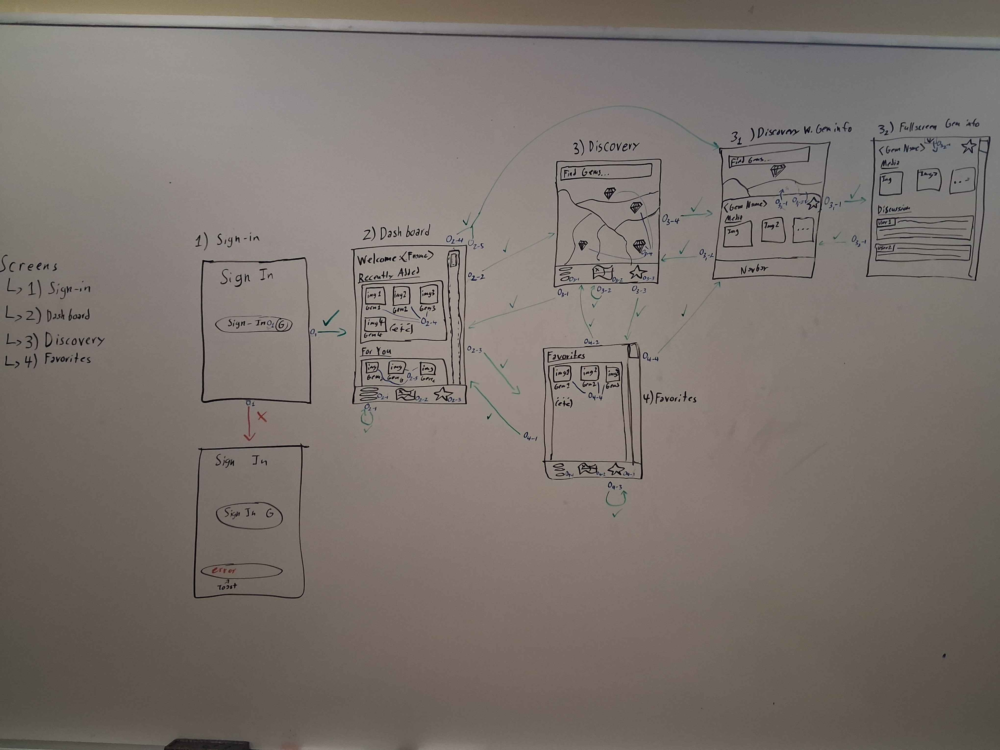

# Requirements and Design

## 1. Change History

| **Change Date**   | **Modified Sections** | **Rationale** |
| ----------------- | --------------------- | ------------- |
| _Nothing to show_ |

---

## 2. Project Description

Excavator is an app designed to let you find niche, high quality locations in your area, or hidden gems. The app features three main screens. A dashboard where users can see the latest gems, a discovery screen, where users can see all the gems in their area on a Google Maps-like screen, and the favorites screen, where users can see all the gems they have added to their favorites. Excavator features a special metric for each gem posted that is known as the Gem Score. The Gem Score, is a score computed from aggregated data from sources such as Google Places that includes data such as the number of reviews, average review quality, as well as Google Trends Data such as how much the place has been searched.

---

## 3. Requirements Specification

### **3.1. List of Features**

### **3.2. Use Case Diagram**

### **3.3. Actors Description**
1. **[WRITE_NAME_HERE]**: ...
2. **[WRITE_NAME_HERE]**: ...

### **3.4. Use Case Description**
- Use cases for feature 1: [WRITE_FEATURE_1_NAME_HERE]
1. **[WRITE_NAME_HERE]**: ...
2. **[WRITE_NAME_HERE]**: ...
- Use cases for feature 2: [WRITE_FEATURE_2_NAME_HERE]
3. **[WRITE_NAME_HERE]**: ...
4. **[WRITE_NAME_HERE]**: ...
...

### **3.5. Formal Use Case Specifications (5 Most Major Use Cases)**

#### Use Case 1: [WRITE_USE_CASE_1_NAME_HERE]

**Description**: ...

**Primary actor(s)**: ... 
    
**Main success scenario**:
1. ...
2. ...

**Failure scenario(s)**:
- 1a. ...
    - 1a1. ...
    - 1a2. ...

- 1b. ...
    - 1b1. ...
    - 1b2. ...
                
- 2a. ...
    - 2a1. ...
    - 2a2. ...

...

#### Use Case 2: [WRITE_USE_CASE_2_NAME_HERE]
...

### **3.6. Screen Mock-ups**

### **3.7. Non-Functional Requirements**

1. **[WRITE_NAME_HERE]**
    - **Description**: ...
    - **Justification**: ...
2. ...

---

## 4. Designs Specification
### **4.1. Main Components**
1. **[WRITE_NAME_HERE]**
    - **Purpose**: ...
    - **Interfaces**: 
        1. ...
            - **Purpose**: ...
        2. ...
2. ...

### **4.2. Databases**
1. **[WRITE_NAME_HERE]**
    - **Purpose**: ...
2. ...

### **4.3. External Modules**
1. **[WRITE_NAME_HERE]** 
- **Purpose**: ...
2. ...

### **4.4. Frameworks and Libraries**
1. **Dagger Hilt**
    - **Purpose**: Manages dependency injection automatically and in a centralized way.
    - **Reason**: Easy management of dependencies and allows for easier implementation of fakes while the frontend waits for backend functionality.
2. **Retrofit**
   - **Purpose**: Allows the client app to make HTTP requests and receive HTTP responses from the backend
   - **Reason**: Being able to define API requests as interfaces, combined with Dagger Hilt's dependency injection means that API calling capabilities become as simple as providing an interface as a dependency to another in-app component.
3. **Google Maps**
   - **Purpose**: Leverage Google Maps APIs to add in-app map capabilities
   - **Reason**: The Discovery Screen portion of our app (where you can see Gems on the map) requires the Google Maps API so that users can see the Gems around them, and gems around the world.

### **4.5. Dependencies Diagram**

### **4.6. Use Case Sequence Diagram (5 Most Major Use Cases)**
1. [**[WRITE_NAME_HERE]**](#uc1)\
[SEQUENCE_DIAGRAM_HERE]
2. ...

### **4.7. Design of Non-Functional Requirements**
1. [**[WRITE_NAME_HERE]**](#nfr1)
    - **Implementation**: ...
2. ...
