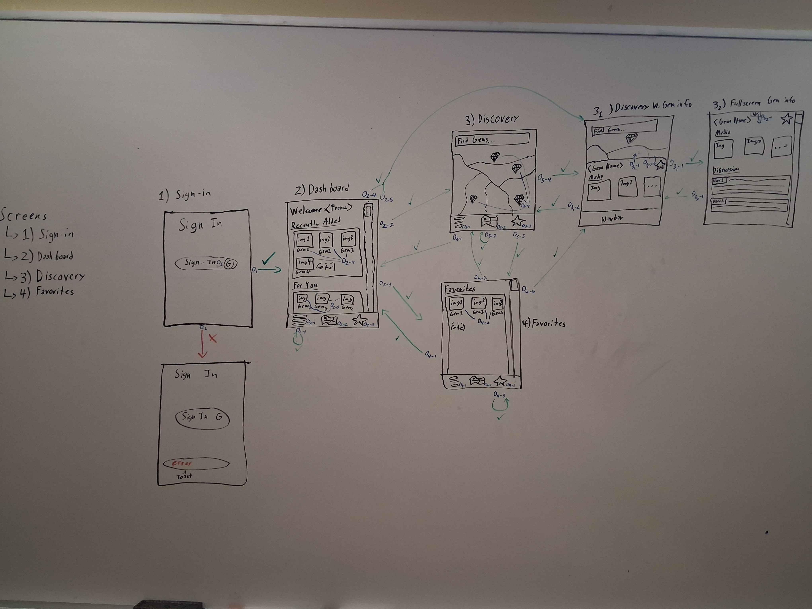

# Requirements and Design

## 1. Change History

| **Change Date**   | **Modified Sections** | **Rationale** |
| ----------------- | --------------------- | ------------- |
| 2026-10-31 | 2 | The Gem Score uses Excavator users' ratings, not Google Trends data, so the description now matches the implementation. |
| 2026-10-31 | 3.7, 4.7 | Added the two non-functional requirements and how they are met; both are tested automatically in `backend/tests/nfr`. |
| 2026-10-31 | 4.1 | Gems: ratings, login on writes, internal interfaces. Live Feed: `gem.updated`. Users: profile routes. New Favorites component. Matches the implemented backend. |
| 2026-10-31 | 4.2 | Added the Favorites and Ratings collections; Gems store rating totals; comments store their author. |
| 2026-10-31 | 4.4 | Added the backend frameworks and libraries. |

---

## 2. Project Description

Excavator is an app designed to let you find niche, high quality locations in your area, or hidden gems. The app features three main screens. A dashboard where users can see the latest gems, a discovery screen, where users can see all the gems in their area on a Google Maps-like screen, and the favorites screen, where users can see all the gems they have added to their favorites. Excavator features a special metric for each gem posted that is known as the Gem Score. The Gem Score is a score from 0 to 100, computed by Excavator from Google Places data (the number of reviews and their average rating) and from Excavator users' own ratings. It rewards places that are both well rated and little known, and it updates live as users rate the gem.

---

## 3. Requirements Specification

### **3.1. List of Features**

### **3.2. Use Case Diagram**

### **3.3. Actors Description**
1. **[WRITE_NAME_HERE]**: ...
2. **[WRITE_NAME_HERE]**: ...

### **3.4. Use Case Description**
- Use cases for feature 1: [WRITE_FEATURE_1_NAME_HERE]
1. **[WRITE_NAME_HERE]**: ...
2. **[WRITE_NAME_HERE]**: ...
- Use cases for feature 2: [WRITE_FEATURE_2_NAME_HERE]
3. **[WRITE_NAME_HERE]**: ...
4. **[WRITE_NAME_HERE]**: ...
...

### **3.5. Formal Use Case Specifications (5 Most Major Use Cases)**

#### Use Case 1: Sign In with Google

**Description**: The user signs in to Excavator with their Google account so they can add, rate, comment on and favorite gems. Excavator creates their account the first time they sign in.

**Primary actor(s)**: User, Google Sign-In

**Main success scenario**:
1. The user opens the app.
2. The app shows the sign-in screen with a "Sign in with Google" button.
3. The user taps "Sign in with Google".
4. The app shows Google's account chooser.
5. The user chooses a Google account.
6. The app sends the account's Google ID token to the Excavator server, which verifies it, creates the user if this is their first sign-in, and returns a session.
7. The app shows the Dashboard.

**Failure scenario(s)**:
- 1a. The user is already signed in and their session has not expired.
    - 1a1. The app skips the sign-in screen and shows the Dashboard.
- 4a. The device has no Google account.
    - 4a1. The app shows the message "Sign in failed!".
    - 4a2. The app stays on the sign-in screen.
- 5a. The user closes the account chooser without choosing an account.
    - 5a1. The app shows the message "Sign-in cancelled".
    - 5a2. The app stays on the sign-in screen.
- 6a. The Excavator server cannot be reached.
    - 6a1. The app shows the message "Failed to connect to server. Please try again later".
    - 6a2. The app stays on the sign-in screen.
- 6b. The Excavator server rejects the Google ID token.
    - 6b1. The app shows the message "Sign in failed!".
    - 6b2. The app stays on the sign-in screen.

#### Use Case 2: Add a Gem

**Description**: The user adds a place near them as a new gem. The place must exist on Google Places, be within 200 m of the user, and not already be a gem. The new gem is scored and appears for the user and for other users nearby.

**Primary actor(s)**: User, Google Places

**Main success scenario**:
1. The user opens the Discovery screen from the navigation bar.
2. The app shows a map centred on the user's location, with markers for the gems around them, and an "Add gem" button.
3. The user taps "Add gem".
4. The app shows the "Add New Gem" sheet with a "Filters" button and a "Submit" button.
5. The user optionally taps "Filters" and selects the types of place they want to add.
6. The user taps "Submit".
7. The app shows a list of the places within 200 m of the user that are not gems yet, nearest first, limited to the selected types.
8. The user taps a place in the list.
9. The app adds the place as a gem and closes the sheet. The new gem appears as a marker on the map and at the top of the Dashboard's latest gems, and is pushed to other users near it.

**Failure scenario(s)**:
- 2a. The user has denied the app access to their location.
    - 2a1. The app shows a dialog explaining that Excavator needs their location, with a button to try again.
    - 2a2. If the user taps the button, the app asks for location access again and continues from step 2 once it is granted.
- 2b. The device's location is turned off.
    - 2b1. The app shows the dialog "Location is turned off" with a "Turn on location" button.
    - 2b2. If the user taps "Turn on location" and turns it on, the app continues from step 2.
- 7a. There are no places within 200 m that are not gems yet.
    - 7a1. The app shows the message "No gem candidates found! Check back later" with an "Ok" button.
    - 7a2. The user taps "Ok" and the app closes the sheet.
- 7b. Google Places is unavailable.
    - 7b1. The app shows the message "Could not load nearby places. Please try again later."
    - 7b2. The sheet stays open on the filters form.
- 9a. Another user added the same place as a gem after the list was shown.
    - 9a1. The app shows the message "This place is already a gem."
    - 9a2. The app reloads the list without that place.
- 9b. The user has moved more than 200 m away from the place.
    - 9b1. The app shows the message "You must be within 200 m of a place to add it."
    - 9b2. The app reloads the list for the user's new location.
- 9c. The Excavator server cannot be reached.
    - 9c1. The app shows the message "Failed to connect to server. Please try again later".
    - 9c2. The list stays open so the user can try again.

#### Use Case 3: Rate a Gem

**Description**: The user gives a gem a personal rating of 1 to 5 stars. Each user has one rating per gem, and rating again replaces it. The rating updates the gem's Gem Score, which updates live for everyone near the gem.

**Primary actor(s)**: User

**Main success scenario**:
1. The user opens a gem, by tapping its marker on the Discovery map or its card on the Dashboard or Favorites screen.
2. The app shows the gem's sheet with its name, its Gem Score, a "Personal rating" row of 5 stars showing the user's current rating (empty if they have not rated it), and its comments.
3. The user taps or drags across the stars to choose a rating from 1 to 5 whole stars.
4. The app saves the rating, keeps the chosen stars filled, and shows the gem's updated Gem Score. Other users near the gem see the updated Gem Score.

**Failure scenario(s)**:
- 3a. The user has already rated the gem.
    - 3a1. The app shows their previous rating in step 2.
    - 3a2. The new rating replaces the previous one in step 4.
- 3b. The user lifts their finger to the left of the first star (no stars chosen).
    - 3b1. The app keeps the user's previous rating and saves nothing.
- 4a. The Excavator server cannot be reached.
    - 4a1. The app shows the message "Could not save your rating. Please try again."
    - 4a2. The stars return to the user's previous rating.

#### Use Case 4: Comment on a Gem

**Description**: The user reads a gem's comments and adds their own. Each comment shows the display name of the user who wrote it.

**Primary actor(s)**: User

**Main success scenario**:
1. The user opens a gem, by tapping its marker on the Discovery map or its card on the Dashboard or Favorites screen.
2. The app shows the gem's sheet with a "Comments" list, oldest first, each comment showing its author's display name and text, and a "New comment..." text field with a "Send Comment" button.
3. The user types a comment of up to 256 characters.
4. The user taps "Send Comment".
5. The app posts the comment, clears the text field, and shows the comment at the bottom of the list with the user's display name.

**Failure scenario(s)**:
- 2a. The gem has no comments yet.
    - 2a1. The app shows "No comments yet!" under "Comments".
- 3a. The user types more than 256 characters.
    - 3a1. The text field does not accept characters beyond the 256th.
- 3b. The user types a new line or a tab.
    - 3b1. The text field ignores it.
- 4a. The text field is empty or contains only spaces.
    - 4a1. The "Send Comment" button is disabled, so nothing is posted.
- 5a. The Excavator server cannot be reached.
    - 5a1. The app shows the message "Could not post your comment. Please try again."
    - 5a2. The comment stays in the text field so the user can send it again.

#### Use Case 5: Manage Favorite Gems

**Description**: The user marks gems as favorites to find them again later, sees them on the Favorites screen, and removes the ones they no longer want. Favorites are stored on the server, so they follow the user to other devices.

**Primary actor(s)**: User

**Main success scenario**:
1. The user opens a gem, by tapping its marker on the Discovery map or its card on the Dashboard.
2. The app shows the gem's sheet with a star button, grey if the gem is not one of the user's favorites and gold if it is.
3. The user taps the grey star.
4. The app saves the gem as a favorite and the star turns gold.
5. The user opens the Favorites screen from the navigation bar.
6. The app shows "Your favorites:" with a card for each favorite gem, most recently added first, each with a gold border and a ★ badge.
7. The user long-presses a gem's card.
8. The app removes the gem from the user's favorites and its card disappears from the screen.

**Failure scenario(s)**:
- 3a. The gem is already a favorite (gold star) and the user taps the star.
    - 3a1. The app removes the gem from the user's favorites and the star turns grey.
- 4a. The user already has 500 favorites.
    - 4a1. The app shows the message "You can have at most 500 favorites."
    - 4a2. The star stays grey.
- 4b. The Excavator server cannot be reached.
    - 4b1. The app shows the message "Could not update your favorites. Please try again."
    - 4b2. The star returns to its previous colour.
- 6a. The user has no favorites.
    - 6a1. The app shows "No favorites yet!" under "Your favorites:".
- 8a. The Excavator server cannot be reached.
    - 8a1. The app shows the message "Could not update your favorites. Please try again."
    - 8a2. The card stays on the screen.

### **3.6. Screen Mock-ups**

### **3.7. Non-Functional Requirements**

1. **Live updates arrive within 1 second**
    - **Description**: When a gem is added, or its Gem Score changes because someone rated it, every user whose map is open within range of it receives the update within 1 second of the request that caused it, even with 250 users connected at once. Users out of range receive nothing.
    - **Justification**: Live updates are what make Excavator's map feel shared; an update that takes several seconds is indistinguishable from refreshing. One second is the usual limit for a response to feel immediate and keep the user's flow (Nielsen, *Usability Engineering*, 1993). 250 concurrent users is several times the number of people expected around the same area during the course demo and peer testing.

2. **The map stays fast with many gems**
    - **Description**: With 10,000 gems stored, 95% of the map's queries (the gems inside the visible map area, and the gems near a point) are answered within 500 ms.
    - **Justification**: The discovery screen re-queries every time the user pans or zooms, so slow queries make the map feel stuck. 500 ms leaves half of the 1-second responsiveness limit for the network and drawing the pins. 10,000 gems is far more than a city will have during the course, so the requirement shows the design keeps working as gems accumulate.

---

## 4. Designs Specification
### **4.1. Main Components**
1. **Gems**
    - **Purpose**: Adds, validates, scores and lists gems, and holds their comments and ratings. A gem is a Google Places place, identified by its Google name `places/<place ID>`. A place can only be added by a signed-in user, if it exists on Google Places and is within 200 m of them. Each gem has a Gem Score from 0 to 100 that rewards places that are both well rated and little known. The Google ratings and Excavator users' ratings are pulled together toward 3.0 when there are few of them: R_adj = (v·rating + u·r_app + 15·3.0) / (v + u + 15), where v is the Google review count and rating its average, and u is the number of Excavator ratings and r_app their average. Quality is Q = (R_adj − 1) / 4, nicheness is N = 1 / (1 + v / 200), and the score is 100 · Q^0.6 · N^0.4. Excavator ratings change quality only, since nicheness measures how well known a place is in general. A Google rating that is missing counts as no rated reviews, but its review count still sets N. Users rate a gem 1–5 stars, once each (rating again replaces their rating); after every rating the gem's rating totals are recounted from all its ratings, its score is recomputed, and the updated gem is pushed to nearby users through the Live Feed.
    - **Interfaces**:
        1. `GET /gem?name=places/<place ID>` → the gem
            - **Purpose**: Gets one gem, for its info sheet.
        2. `POST /gem { name, latitude, longitude }` → 201 with the new gem (requires login)
            - **Purpose**: Adds a place as a gem, recording the signed-in user as `addedBy`. `latitude` / `longitude` are the user's location; the place must be within 200 m. The new gem is scored and pushed to nearby users through the Live Feed. Returns 400 if `name` or the location is malformed, 401 if not signed in, 409 if the gem already exists, 422 if the place doesn't exist or is too far away, and 502 if Google Places is unavailable.
        3. `GET /gem/nearby?lat&lng[&radius][&limit]` → gems, nearest first
            - **Purpose**: Gems around the user, for the dashboard and discovery screen.
        4. `GET /gem/within?south&west&north&east[&limit]` → gems, highest Gem Score first
            - **Purpose**: Gems inside the visible map area, for the discovery screen.
        5. `GET /gem/newest[?limit]` → gems, newest first
            - **Purpose**: The latest gems, for the dashboard.
        6. `GET /gem/:pk/comments` → `[{ id, body, author, authorName }]`, oldest first; `POST /gem/:pk/comments { body }` → 201 `{ id, body, author, authorName }` (posting requires login)
            - **Purpose**: Reads and adds the comments of the gem whose place ID is `pk`. A new comment records the signed-in user and their display name.
        7. `PUT /gem/:pk/rating { stars }` → `{ stars, gem }`; `GET /gem/:pk/rating` → `{ stars }` (both require login)
            - **Purpose**: Sets the signed-in user's 1–5 star rating of the gem, returning the gem with its new rating totals and Gem Score; or reads their rating (404 if they haven't rated it).
        8. `GET /place/nearby?lat&lng[&type]` → up to 20 places within 200 m, nearest first, each with `isGem`
            - **Purpose**: Lets the user pick a place that isn't labelled on the map when adding a gem; the app then sends its `name` to `POST /gem`.
        9. `boolean hasGem(String name)`
            - **Purpose**: Used by Favorites and by comments and ratings to check a gem exists before acting on it.
        10. `List<Gem> getGems(List<String> names)`
            - **Purpose**: Used by Favorites to load a user's favorite gems in one query, in the order given; names with no gem are left out.
    - Any other method on these paths gets 405 with an `Allow` header.
2. **Live Feed**
    - **Purpose**: Pushes newly added gems, and gems whose Gem Score changed after a rating, to the users near them as they happen, so other users' actions appear on the map without refreshing. It runs as a WebSocket on the same server as the REST API. Each connected app tells the server where it is, and when a gem is added or changes, the server sends it to every app whose area contains it. A WebSocket was chosen over polling because new gems should show up immediately and an idle connection costs almost nothing, while polling would mean many empty requests.
    - **Interfaces**:
        1. WebSocket `/feed`, client → server: `{ type: "subscribe", latitude, longitude, radius? }`; server → client: `{ type: "subscribed", latitude, longitude, radius }`
            - **Purpose**: Starts listening for new gems within `radius` metres of the user (default 5000, max 50000). Sending it again moves the area, at most once a second. Invalid messages get `{ type: "error", message }` and the connection stays open.
        2. WebSocket `/feed`, server → client: `{ type: "gem.added", gem }`
            - **Purpose**: A gem was just added within the client's area; `gem` is the same gem JSON that `POST /gem` returns.
        3. WebSocket `/feed`, server → client: `{ type: "gem.updated", gem }`
            - **Purpose**: A gem within the client's area changed, e.g. its Gem Score after someone rated it; `gem` is the gem as it is now.
        4. `int publishGemAdded(Gem gem)` and `int publishGemUpdated(Gem gem)`
            - **Purpose**: Called by Gems after a gem is stored or rescored; sends it to every subscribed client in range and returns how many it was sent to. A failure here never fails adding or rating the gem.
3. **Users**
    - **Purpose**: Signs users in with Google and keeps their profile (Google name and display name). After verifying the Google ID token, the server issues its own JSON Web Token (JWT), valid for 7 days, which the app sends as `Authorization: Bearer <token>`. A JWT was chosen over server-side sessions because it survives server restarts and needs no session store; the server still checks the user exists on every request.
    - **Interfaces**:
        1. `POST /user/auth/google { idToken }` → `{ sessionId }`
            - **Purpose**: Signs in with a Google ID token, creating the user on their first sign-in. `sessionId` holds the JWT.
        2. `GET /user/me` → `{ id, name, displayName }`; `PATCH /user/me { displayName }` → the updated profile (both require login)
            - **Purpose**: Reads the signed-in user's profile, and sets the display name other users see on their comments (1–50 characters). Signing out is done on the app by discarding the token.
        3. `void reqJwt(Request req, Response res, NextFunction next)`
            - **Purpose**: Express middleware for routes that need a signed-in user: checks the Bearer JWT, loads the user into `req.user`, and answers 401 otherwise. Used by Gems, Favorites and Users.
        4. `User currentUser(Request req)`
            - **Purpose**: Gives a route handler that runs after `reqJwt` the signed-in user, e.g. for a gem's `addedBy`.
4. **Favorites**
    - **Purpose**: Keeps each user's favorite gems on the server, so they follow the user to a new phone and stay separate when several people use the same phone. Every route acts on the signed-in user's own list, so no user ID appears in the URL and nobody can read or change someone else's favorites. Adding a favorite twice changes nothing; a user can have up to 500.
    - **Interfaces**:
        1. `GET /user/favorites` → the favorite gems, most recently added first (requires login)
            - **Purpose**: Loads the favorites screen.
        2. `POST /user/favorites { gem }` → 201 `{ gem }`, or 200 if it already was a favorite (requires login)
            - **Purpose**: Adds a gem to the user's favorites. Returns 404 if the gem doesn't exist and 409 at the 500-favorite limit.
        3. `DELETE /user/favorites/:placeId` → 204 (requires login)
            - **Purpose**: Removes a gem from the user's favorites; 404 if it wasn't one.

### **4.2. Databases**
1. **Gems DB (MongoDB, `gems` collection)**
    - **Purpose**: Stores every gem in Excavator. Each gem holds its Google Places place (place ID, display name and location), its type and description, the user who added it, and its Gem Score together with the inputs the score is computed from (the Google rating and review count, the nicheness derived from the review count, and the number and average of Excavator users' ratings) and the time the score was last computed. The location is indexed for geospatial queries, so the discovery screen can load the gems around the user and the dashboard can show nearby gems. Gems are also indexed by type for filtering and by Gem Score for recommendations.
2. **Users DB (MongoDB, `users` collection)**
    - **Purpose**: Stores every Excavator user, keyed by their Google account ID. Each user holds their name from Google and the display name shown to other users. A user is created the first time they sign in with Google, and the same ID is what each gem stores as the user who added it.
3. **Comments DB (MongoDB, `comments` collection)**
    - **Purpose**: Stores the comments users leave on gems. Comments are a weak entity of gems (many comments to one gem): each comment belongs to exactly one gem and is identified by that gem together with its own comment ID, and holds the comment body, the user who wrote it, and their display name at the time (so listing comments needs no user lookups). Comments are indexed by gem, so a gem's comments can be listed oldest first.
4. **Ratings DB (MongoDB, `ratings` collection)**
    - **Purpose**: Stores users' 1–5 star ratings of gems. Ratings are a weak entity of gems, identified by their gem together with the user who gave them, so a user has at most one rating per gem and rating again replaces it. After each rating, MongoDB recounts the gem's ratings and their average, which are stored on the gem for its Gem Score.
5. **Favorites DB (MongoDB, `favorites` collection)**
    - **Purpose**: Stores which gems each user marked as favorites. Users and gems are many-to-many through favorites, so each favorite is its own document identified by the user and the gem together, rather than a list on the user: this keeps them in the order they were added, makes adding the same favorite twice harmless, and keeps user documents small. Favorites are indexed by user and date, so a user's favorites are listed newest first.

### **4.3. External Modules**
1. **Google Places API (New)**
    - **Purpose**: Verifies that a place exists and gets its name, location, type, description, rating and review count when it is added as a gem (Place Details), and lists the places near the user when adding a gem (Nearby Search). Only the backend calls it, so the API key stays on the server.
2. **Google Sign-In**
    - **Purpose**: Authenticates users. The app gets a Google ID token, and the backend verifies it and reads the user's Google account ID and name from it.

### **4.4. Frameworks and Libraries**
1. **Dagger Hilt**
    - **Purpose**: Manages dependency injection automatically and in a centralized way.
    - **Reason**: Easy management of dependencies and allows for easier implementation of fakes while the frontend waits for backend functionality.
2. **Retrofit**
   - **Purpose**: Allows the client app to make HTTP requests and receive HTTP responses from the backend
   - **Reason**: Being able to define API requests as interfaces, combined with Dagger Hilt's dependency injection means that API calling capabilities become as simple as providing an interface as a dependency to another in-app component.
3. **Google Maps**
   - **Purpose**: Leverage Google Maps APIs to add in-app map capabilities
   - **Reason**: The Discovery Screen portion of our app (where you can see Gems on the map) requires the Google Maps API so that users can see the Gems around them, and gems around the world.
4. **Express**
   - **Purpose**: The backend's HTTP server and routing, including nested routers for a gem's comments and rating.
   - **Reason**: The most widely used Node.js web framework, with middleware that suits cross-cutting checks such as login (`reqJwt`).
5. **Mongoose (MongoDB)**
   - **Purpose**: Defines the collections and their indexes, and queries MongoDB, including the geospatial queries for the map.
   - **Reason**: Schemas and typed models on top of MongoDB, whose 2dsphere indexes answer "gems near here" and "gems in this area" directly.
6. **ws**
   - **Purpose**: The Live Feed's WebSocket server, on the same port as the REST API.
   - **Reason**: A small, standard WebSocket library with no client protocol of its own, so the Android app can use OkHttp's built-in WebSocket client.
7. **jsonwebtoken**
   - **Purpose**: Signs and verifies the login tokens (JWTs) the app sends with each request.
   - **Reason**: The standard JWT library for Node.js.
8. **google-auth-library and @googlemaps/places**
   - **Purpose**: Google's official clients for verifying Google sign-in tokens and calling the Places API.
   - **Reason**: Maintained by Google, and handle authentication and retries for us.
9. **Jest, Supertest and mongodb-memory-server**
   - **Purpose**: Backend tests: Jest runs them and measures coverage, Supertest sends HTTP requests to the app, and mongodb-memory-server runs a real MongoDB in memory for the tests without mocks.
   - **Reason**: Jest is the course's required framework; the other two let the no-mock and non-functional tests use the real app and database without any setup.

### **4.5. Dependencies Diagram**

### **4.6. Use Case Sequence Diagram (5 Most Major Use Cases)**
1. [**[WRITE_NAME_HERE]**](#uc1)\
[SEQUENCE_DIAGRAM_HERE]
2. ...

### **4.7. Design of Non-Functional Requirements**
1. [**Live updates arrive within 1 second**](#nfr1)
    - **Implementation**: Updates are pushed over an open WebSocket rather than polled, so an update leaves the server as soon as the gem is stored. The feed keeps every connection's location in memory, and publishing is a single pass that checks each connection's distance to the gem and sends to those in range; it never touches the database. Publishing happens right after the write and never makes the request wait for or fail on it. Dead connections are dropped by a heartbeat so they don't slow publishing down. Verified by `backend/tests/nfr/feedLatency.test.ts` with 200 users in range and 50 out of range.
2. [**The map stays fast with many gems**](#37-non-functional-requirements)
    - **Implementation**: Gem locations are stored as GeoJSON points with a 2dsphere index, so MongoDB answers "gems near this point" (`$nearSphere`) and "gems inside this map area" (`$geoWithin`) from the index instead of scanning every gem; gems are also indexed by Gem Score for the "best first" order. Every map query has a result limit (at most 50), so responses stay small however many gems match. Verified by `backend/tests/nfr/mapQueryTime.test.ts` with 10,000 gems.
