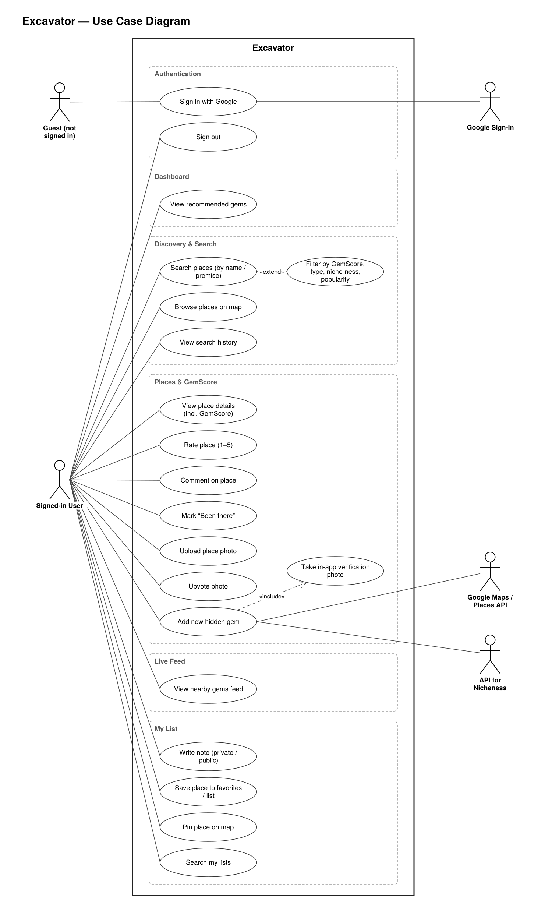
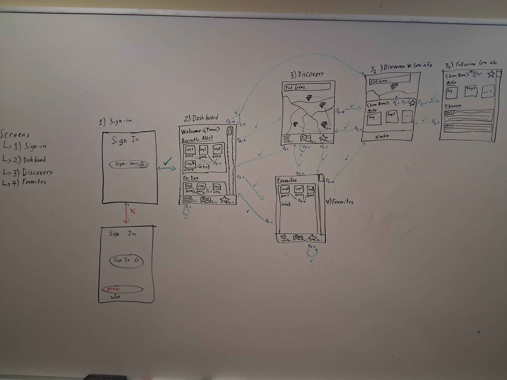
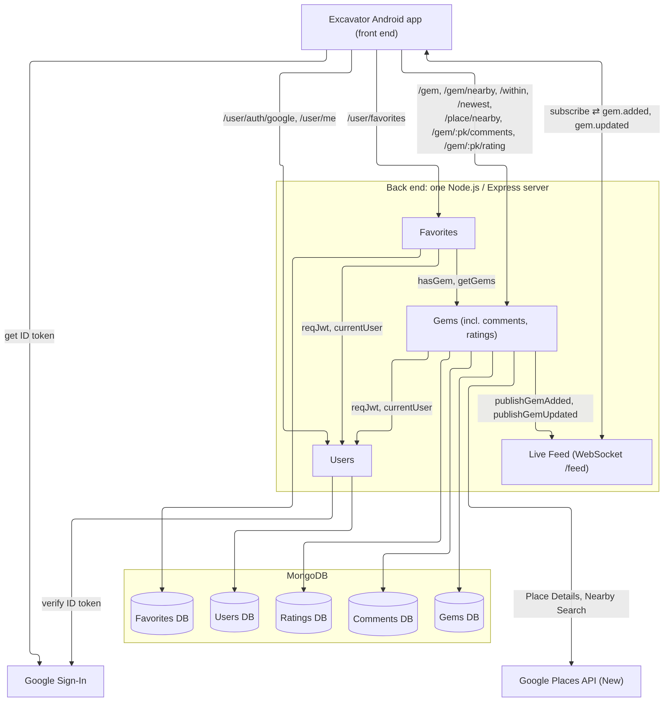
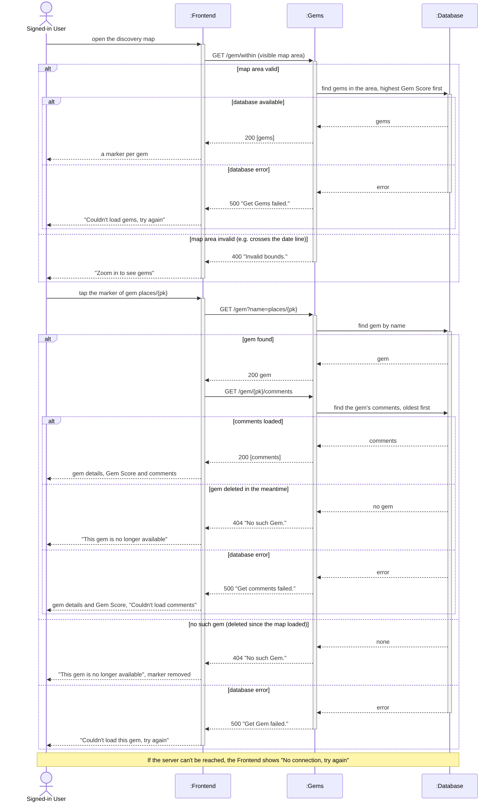
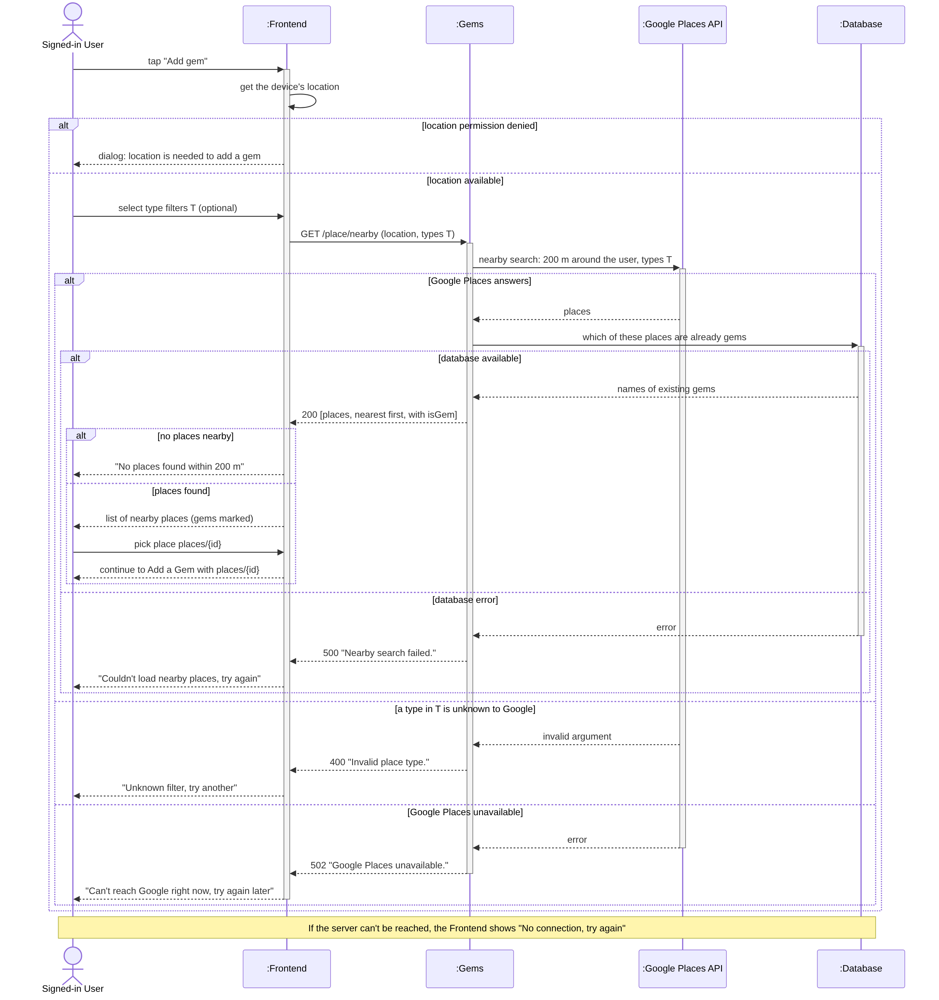
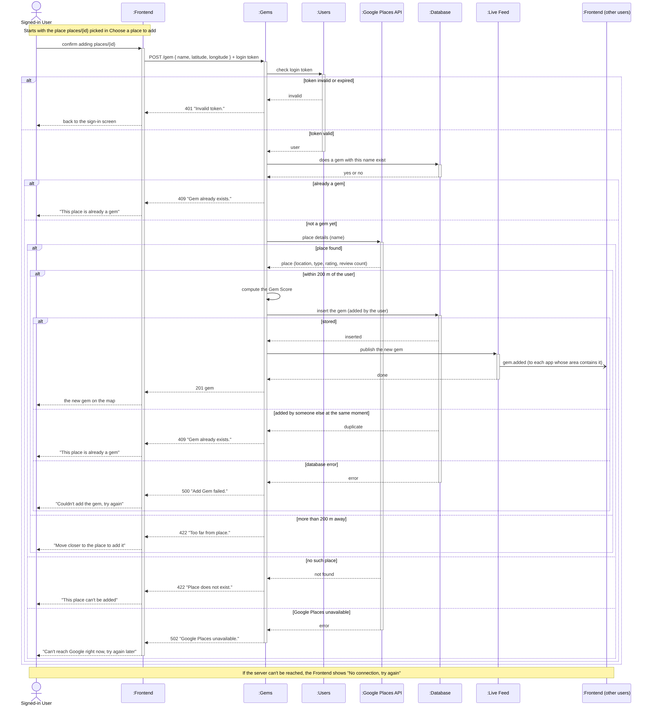
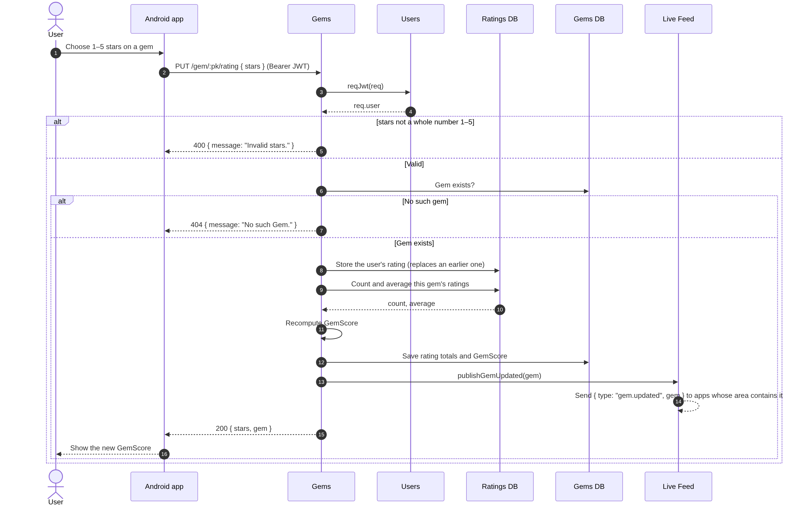
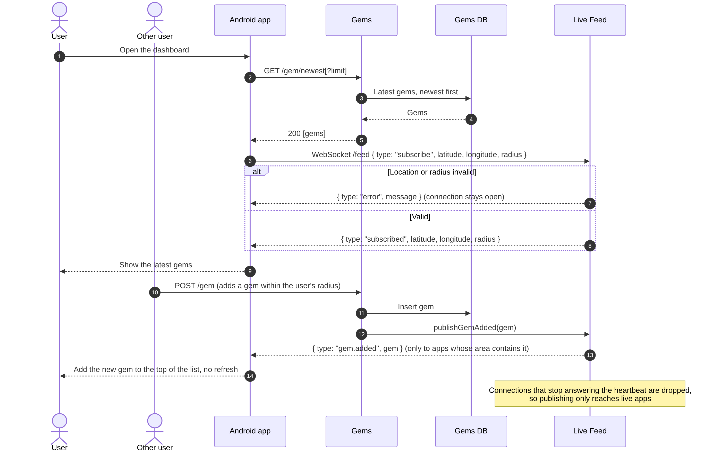
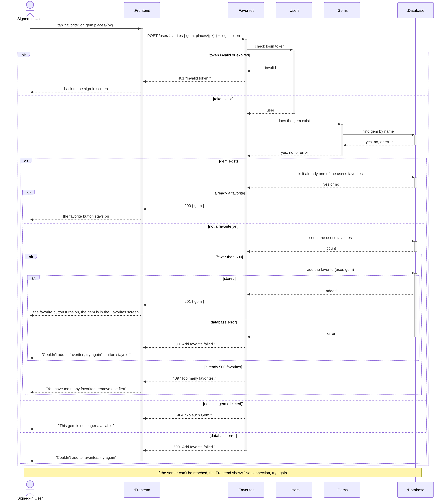

# Requirements and Design

## 1. Change History

| **Change Date**   | **Modified Sections** | **Rationale** |
| ----------------- | --------------------- | ------------- |
| 2026-10-31 | 2 | The Gem Score uses Excavator users' ratings, not Google Trends data, so the description now matches the implementation. |
| 2026-10-31 | 3.7, 4.7 | Added the two non-functional requirements and how they are met; both are tested automatically in `backend/tests/nfr`. |
| 2026-10-31 | 4.1 | Gems: ratings, login on writes, internal interfaces. Live Feed: `gem.updated`. Users: profile routes. New Favorites component. Matches the implemented backend. |
| 2026-10-31 | 4.2 | Added the Favorites and Ratings collections; Gems store rating totals; comments store their author. |
| 2026-10-31 | 4.4 | Added the backend frameworks and libraries. |
| 2026-11-03 | 4.5 | Added the dependencies diagram: front end, the four back-end components, the five MongoDB collections and the two Google services, with the interfaces each arrow uses. |
| 2026-11-03 | 4.6 | Added sequence diagrams for the five major use cases (View a Gem, Add a Gem, Contribute to GemScore, View new Gems nearby, Initialize session), using the components and interfaces of 4.1 and 4.5. |
| 2026-11-03 | 4.1 | Corrected the interfaces to match the code: `GET /user/me` returns `name` as an object; feed messages over 1024 bytes close the connection; rating and favorites routes answer 401 before 405; added default and maximum values (radius, limit, comment and display-name length) and the missing 400, 401 and 404 responses. |
| 2026-11-04 | 4.1 | `GET /place/nearby` now takes several place types in `type`, so the app can search with all the filters the user selected. |
| 2026-11-04 | 3.1, 3.2, 3.3, 3.4 | Updated the features, use case diagram, actors and use cases to match the implemented app: added Favorites, Browse Gems on the map, Choose a place to add, Sign out and Edit display name; removed the nicheness API (nicheness is computed by the Gem Score formula) and "Authenticate API calls" (the app does it on every request; it is not a user goal); described the Google actors. |
| 2026-11-04 | 4.5, 4.6 | Redid the diagrams to the course conventions: every synchronous call has a labelled return, WebSocket messages are asynchronous, database calls are the real queries, error cases are in `alt` frames, values flow from earlier messages, and lifeline and actor names match 3.3 and 4.5 (Frontend, Google Places API, Signed-in User, Guest). |
| 2026-11-04 | 4.5, 4.6 | Simplified the diagrams to a high level: one database, plain-language labels instead of function names. Every failure is now an `alt` branch at the step where it happens. Add a Gem is split into Choose a place to add and adding the picked place, so a failed search ends the flow. |
| 2026-11-04 | 3.5, 4.6 | Wrote the five formal use cases (View a Gem, Add a Gem, Contribute to GemScore, View new Gems nearby, Mark a Gem as favorite) with every failure scenario. Replaced Initialize session with Mark a Gem as favorite, since the formal use cases must exclude authentication. Add a Gem now matches the app: the place is picked from the list of nearby places. |

---

## 2. Project Description

Excavator is an app designed to let you find niche, high quality locations in your area, or hidden gems. The app features three main screens. A dashboard where users can see the latest gems, a discovery screen, where users can see all the gems in their area on a Google Maps-like screen, and the favorites screen, where users can see all the gems they have added to their favorites. Excavator features a special metric for each gem posted that is known as the Gem Score. The Gem Score is a score from 0 to 100, computed by Excavator from Google Places data (the number of reviews and their average rating) and from Excavator users' own ratings. It rewards places that are both well rated and little known, and it updates live as users rate the gem.

---

## 3. Requirements Specification

### **3.1. List of Features**
1. **Authentication**: Users sign in with their Google account (Google OAuth). The server then issues its own login token (JWT), which the app sends with every request. Users can set the display name other users see.
2. **Gems and Gem Score**: A gem is a real place that users add from nearby places. Each gem has a Gem Score from 0 to 100 that rewards places that are both well rated and little known. Users browse gems on a map and open a gem to see its details and score.
3. **Live feed**: New gems, and gems whose Gem Score changed, appear in real time for users near them, without refreshing.
4. **In-app ratings**: Users rate gems from 1 to 5 stars, and their ratings feed into the gem's Gem Score.
5. **Comments**: Users read and write comments on gems.
6. **Favorites**: Users save gems to a favorites list that follows their account.

### **3.2. Use Case Diagram**

### **3.3. Actors Description**
1. **Guest**: Someone who has opened the app but not signed in. The only thing they can do is sign in.
2. **Signed-in User**: Someone signed in with their Google account. They use every feature of the app. There is no admin or other role.
3. **Google Sign-In**: Google's authentication service. It signs the user in and gives the app an ID token, which the server verifies.
4. **Google Places API**: Google's place database. It lists the places near a user who is adding a gem, and gives the chosen place's location, rating and review count.

### **3.4. Use Case Description**
- Use cases for feature 1: Authentication
1. **Initialize session**: A Guest signs in with Google, the first time or after their login has expired, and becomes a Signed-in User.
2. **Sign out**: The User signs out, and the app forgets their login.
3. **Edit display name**: The User sets the name other users see on their comments.

- Use cases for feature 2: Gems and Gem Score
4. **Browse Gems on the map**: The User sees the gems in the area shown on the map, highest Gem Score first.
5. **View a Gem**: The User opens a gem and sees its details, its Gem Score and its comments.
6. **Add a Gem**: The User adds a place within 200 m of them as a gem; the gem is then scored and shared with nearby users.
7. **Choose a place to add**: While adding a gem, the User picks from the places near them, optionally filtered by type (e.g. café, park).

- Use cases for feature 3: Live feed
8. **View newest Gems**: The User opens the dashboard and sees the most recently added gems.
9. **View new Gems nearby**: With the app open, gems added near the User, and gems whose Gem Score changed, appear without refreshing.

- Use cases for feature 4: In-app ratings
10. **Contribute to GemScore**: The User rates a gem from 1 to 5 stars; the gem's Gem Score is recomputed right away and shown to nearby users.

- Use cases for feature 5: Comments
11. **View comments**: The User sees a gem's comments, oldest first, while viewing it.
12. **Make comments**: While viewing a gem, the User writes a comment and posts it; it shows their display name.

- Use cases for feature 6: Favorites
13. **Mark a Gem as favorite**: The User taps "favorite" on a gem to add it to their favorites.
14. **View favorites**: The User opens the favorites screen and sees their favorite gems, most recently added first.
15. **Remove a favorite**: The User removes a gem from their favorites.

### **3.5. Formal Use Case Specifications (5 Most Major Use Cases)**

#### Use Case 1: View a Gem
**Description**: A Signed-in User finds a gem on the map or the dashboard and opens it to see its details, Gem Score and comments.

**Primary actor(s)**: Signed-in User

**Main success scenario**:
1. The User opens the Discovery screen.
2. The app shows a marker for each gem in the visible map area.
3. The User taps a gem's marker (or a gem card on the Dashboard).
4. A half-height panel appears with the gem's name, type and Gem Score.
5. The User pulls up the panel to full screen.
6. The app shows the gem's full details and its comments, oldest first.

**Failure scenario(s)**:
- 2a. The gems can't be loaded (no connection, or a server error).
    - 2a1. The app shows "Couldn't load gems, try again" and a retry option.
- 2b. The visible map area is too large to search (e.g. it crosses the date line).
    - 2b1. The app asks the User to zoom in.
- 4a. The gem no longer exists (it was deleted after the map loaded).
    - 4a1. The app shows "This gem is no longer available".
    - 4a2. The app removes the gem's marker from the map.
- 4b. The gem can't be loaded (no connection, or a server error) and it is not cached.
    - 4b1. The panel appears with a message about the error and a retry option.
- 6a. The comments can't be loaded.
    - 6a1. The app shows the gem's details with "Couldn't load comments" and a retry option.

#### Use Case 2: Add a Gem
**Description**: A Signed-in User adds a place near them as a gem, picking it from a list of nearby places that can be filtered by type (this includes *Choose a place to add*). The new gem is scored and shown to nearby users.

**Primary actor(s)**: Signed-in User

**Main success scenario**:
1. The User taps "Add gem" on the Discovery screen.
2. The app gets the User's location, asking for location permission if it hasn't been granted.
3. The User optionally selects type filters (e.g. café, park).
4. The app lists the places within 200 m of the User, nearest first, and marks the ones that are already gems.
5. The User picks a place and confirms adding it.
6. The app shows the new gem, with its Gem Score, on the map.
7. Other users with that area open see the new gem appear without refreshing.

**Failure scenario(s)**:
- 2a. The User denies location permission.
    - 2a1. The app explains that the location is needed to add a gem.
    - 2a2. The app returns to the Discovery screen.
- 4a. There are no places within 200 m (for the selected filters).
    - 4a1. The app shows "No places found within 200 m".
    - 4a2. The User can change the filters or move and try again.
- 4b. A selected filter is not a type Google Places knows.
    - 4b1. The app shows "Unknown filter, try another".
- 4c. Google Places is unavailable.
    - 4c1. The app shows "Can't reach Google right now, try again later".
- 5a. The place is already a gem (for example, another User added it at almost the same time).
    - 5a1. The app shows that the place is already a gem.
    - 5a2. The map is updated, so the place shows up as a gem.
- 5b. The User is more than 200 m from the place.
    - 5b1. The app shows "Move closer to the place to add it".
- 5c. The place no longer exists on Google Places.
    - 5c1. The app shows "This place can't be added".
- 5d. The User's login has expired.
    - 5d1. The app returns to the sign-in screen; after signing in, the User can try again.
- 5e. The gem can't be added (no connection, a server error, or Google Places is unavailable).
    - 5e1. The app shows "Couldn't add the gem, try again". Nothing is added.

#### Use Case 3: Contribute to GemScore
**Description**: A Signed-in User rates a gem from 1 to 5 stars; the gem's Gem Score is recomputed right away and shown to nearby users.

**Primary actor(s)**: Signed-in User

**Main success scenario**:
1. The User opens a gem (Use Case 1).
2. The User selects 1 to 5 stars.
3. The app shows the gem's new Gem Score. If the User had rated the gem before, the new rating replaces the old one.
4. Other users with that area open see the gem's new Gem Score without refreshing.

**Failure scenario(s)**:
- 3a. The gem no longer exists.
    - 3a1. The app shows "This gem is no longer available".
- 3b. The User's login has expired.
    - 3b1. The app returns to the sign-in screen; after signing in, the User can rate again.
- 3c. The rating can't be saved (no connection, or a server error).
    - 3c1. The app shows "Couldn't save your rating, try again".
    - 3c2. The gem keeps its previous Gem Score and the User's previous rating.

#### Use Case 4: View new Gems nearby
**Description**: A Signed-in User with the Dashboard open sees the newest gems, and gems that are added or re-scored near them appear without refreshing.

**Primary actor(s)**: Signed-in User

**Main success scenario**:
1. The User opens the Dashboard.
2. The app shows the most recently added gems.
3. The app starts receiving live updates for the area around the User, asking for location permission if it hasn't been granted.
4. When another User adds a gem near the User, it appears at the top of the list.
5. When a gem near the User is rated, its Gem Score is updated in place.

**Failure scenario(s)**:
- 2a. The gems can't be loaded (no connection, or a server error).
    - 2a1. The app shows "Couldn't load gems, try again" and a retry option.
- 3a. The User denies location permission.
    - 3a1. The app explains that the location is needed for live updates.
    - 3a2. The list still shows the newest gems, without live updates.
- 4a. The live-update connection is lost.
    - 4a1. New gems stop appearing until the connection is restored or the Dashboard is reopened.

#### Use Case 5: Mark a Gem as favorite
**Description**: A Signed-in User adds a gem to their favorites, which they can see on the Favorites screen from any phone they sign in on.

**Primary actor(s)**: Signed-in User

**Main success scenario**:
1. The User opens a gem (Use Case 1).
2. The User taps the favorite button.
3. The favorite button turns on, and the gem appears at the top of the Favorites screen.

**Failure scenario(s)**:
- 2a. The gem is already one of the User's favorites.
    - 2a1. The favorite button stays on; nothing changes.
- 2b. The User already has 500 favorites.
    - 2b1. The app shows "You have too many favorites, remove one first".
- 2c. The gem no longer exists.
    - 2c1. The app shows "This gem is no longer available".
- 2d. The User's login has expired.
    - 2d1. The app returns to the sign-in screen; after signing in, the User can try again.
- 2e. The favorite can't be saved (no connection, or a server error).
    - 2e1. The app shows "Couldn't add to favorites, try again", and the favorite button stays off.

### **3.6. Screen Mock-ups**

### **3.7. Non-Functional Requirements**

1. **Live updates arrive within 1 second**
    - **Description**: When a gem is added, or its Gem Score changes because someone rated it, every user whose map is open within range of it receives the update within 1 second of the request that caused it, even with 250 users connected at once. Users out of range receive nothing.
    - **Justification**: Live updates are what make Excavator's map feel shared; an update that takes several seconds is indistinguishable from refreshing. One second is the usual limit for a response to feel immediate and keep the user's flow (Nielsen, *Usability Engineering*, 1993). 250 concurrent users is several times the number of people expected around the same area during the course demo and peer testing.

2. **The map stays fast with many gems**
    - **Description**: With 10,000 gems stored, 95% of the map's queries (the gems inside the visible map area, and the gems near a point) are answered within 500 ms.
    - **Justification**: The discovery screen re-queries every time the user pans or zooms, so slow queries make the map feel stuck. 500 ms leaves half of the 1-second responsiveness limit for the network and drawing the pins. 10,000 gems is far more than a city will have during the course, so the requirement shows the design keeps working as gems accumulate.

---

## 4. Designs Specification
### **4.1. Main Components**
1. **Gems**
    - **Purpose**: Adds, validates, scores and lists gems, and holds their comments and ratings. A gem is a Google Places place, identified by its Google name `places/<place ID>`. A place can only be added by a signed-in user, if it exists on Google Places and is within 200 m of them. Each gem has a Gem Score from 0 to 100 that rewards places that are both well rated and little known. The Google ratings and Excavator users' ratings are pulled together toward 3.0 when there are few of them: R_adj = (v·rating + u·r_app + 15·3.0) / (v + u + 15), where v is the Google review count and rating its average, and u is the number of Excavator ratings and r_app their average. Quality is Q = (R_adj − 1) / 4, nicheness is N = 1 / (1 + v / 200), and the score is 100 · Q^0.6 · N^0.4. Excavator ratings change quality only, since nicheness measures how well known a place is in general. A Google rating that is missing counts as no rated reviews, but its review count still sets N. Users rate a gem 1–5 stars, once each (rating again replaces their rating); after every rating the gem's rating totals are recounted from all its ratings, its score is recomputed, and the updated gem is pushed to nearby users through the Live Feed.
    - **Interfaces**:
        1. `GET /gem?name=places/<place ID>` → the gem
            - **Purpose**: Gets one gem, for its info sheet. Returns 400 if `name` is missing or not `places/<place ID>` (the database is not queried), and 404 if no gem has that name.
        2. `POST /gem { name, latitude, longitude }` → 201 with the new gem (requires login)
            - **Purpose**: Adds a place as a gem, recording the signed-in user as `addedBy`. `latitude` / `longitude` are the user's location; the place must be within 200 m. The new gem is scored and pushed to nearby users through the Live Feed. Returns 400 if `name` or the location is malformed, 401 if not signed in, 409 if the gem already exists, 422 if the place doesn't exist or is too far away, and 502 if Google Places is unavailable.
        3. `GET /gem/nearby?lat&lng[&radius][&limit]` → gems, nearest first
            - **Purpose**: Gems around the user, for the dashboard and discovery screen. `radius` is in metres, 5000 by default and at most 50000; `limit` is 20 by default and at most 50. Returns 400 if the location is missing or out of range, or if `radius` or `limit` is not a whole number in range.
        4. `GET /gem/within?south&west&north&east[&limit]` → gems, highest Gem Score first
            - **Purpose**: Gems inside the visible map area, for the discovery screen. `limit` is 20 by default and at most 50. The area must not cross the antimeridian. Returns 400 if a bound is missing or out of range, south ≥ north, west ≥ east, or `limit` is invalid.
        5. `GET /gem/newest[?limit]` → gems, newest first
            - **Purpose**: The latest gems, for the dashboard. `limit` is 20 by default and at most 50; 400 if it is invalid.
        6. `GET /gem/:pk/comments` → `[{ id, body, author, authorName }]`, oldest first; `POST /gem/:pk/comments { body }` → 201 `{ id, body, author, authorName }` (posting requires login)
            - **Purpose**: Reads and adds the comments of the gem whose place ID is `pk`. A new comment records the signed-in user and their display name. The body is trimmed and must then be 1–1000 characters with no control characters. Both return 400 if `pk` is not a valid place ID and 404 if no gem has it; posting also returns 400 for an invalid body and 401 if not signed in.
        7. `PUT /gem/:pk/rating { stars }` → `{ stars, gem }`; `GET /gem/:pk/rating` → `{ stars }` (both require login)
            - **Purpose**: Sets the signed-in user's 1–5 star rating of the gem, returning the gem with its new rating totals and Gem Score; or reads their rating. Both return 400 if `pk` is not a valid place ID, 401 if not signed in, and 404 if no gem has that place ID. `PUT` also returns 400 if `stars` is not a whole number from 1 to 5; `GET` returns 404 if the user hasn't rated the gem.
        8. `GET /place/nearby?lat&lng[&type=cafe,park]` → up to 20 places within 200 m, nearest first, each with `isGem`
            - **Purpose**: Lets the user pick a place that isn't labelled on the map when adding a gem; the app then sends its `name` to `POST /gem`. `type` optionally limits the list to one or more Google Places types, comma-separated (`type=cafe,park`) or repeated (`type=cafe&type=park`), so the app can send all the filters the user selected; a place matching any of them is listed. Returns 400 if the location is invalid, or a type is empty, malformed or unknown to Google, or there are more than 50, and 502 if Google Places is unavailable.
        9. `boolean hasGem(String name)`
            - **Purpose**: Used by Favorites and by comments and ratings to check a gem exists before acting on it.
        10. `List<Gem> getGems(List<String> names)`
            - **Purpose**: Used by Favorites to load a user's favorite gems in one query, in the order given; names with no gem are left out.
    - Any other method on these paths gets 405 with an `Allow` header. The rating routes check login first, so another method on `/gem/:pk/rating` without a valid token gets 401 instead.
2. **Live Feed**
    - **Purpose**: Pushes newly added gems, and gems whose Gem Score changed after a rating, to the users near them as they happen, so other users' actions appear on the map without refreshing. It runs as a WebSocket on the same server as the REST API. Each connected app tells the server where it is, and when a gem is added or changes, the server sends it to every app whose area contains it. A WebSocket was chosen over polling because new gems should show up immediately and an idle connection costs almost nothing, while polling would mean many empty requests.
    - **Interfaces**:
        1. WebSocket `/feed`, client → server: `{ type: "subscribe", latitude, longitude, radius? }`; server → client: `{ type: "subscribed", latitude, longitude, radius }`
            - **Purpose**: Starts listening for new gems within `radius` metres of the user (default 5000, max 50000). Sending it again moves the area, at most once a second. An invalid message (not JSON, a binary message, an unknown `type`, a location or radius out of range, or a second subscribe within a second) gets `{ type: "error", message }` and the connection stays open. A message over 1024 bytes closes the connection instead (WebSocket close code 1009).
        2. WebSocket `/feed`, server → client: `{ type: "gem.added", gem }`
            - **Purpose**: A gem was just added within the client's area; `gem` is the same gem JSON that `POST /gem` returns.
        3. WebSocket `/feed`, server → client: `{ type: "gem.updated", gem }`
            - **Purpose**: A gem within the client's area changed, e.g. its Gem Score after someone rated it; `gem` is the gem as it is now.
        4. `int publishGemAdded(Gem gem)` and `int publishGemUpdated(Gem gem)`
            - **Purpose**: Called by Gems after a gem is stored or rescored; sends it to every subscribed client in range and returns how many it was sent to. A failure here never fails adding or rating the gem.
3. **Users**
    - **Purpose**: Signs users in with Google and keeps their profile (Google name and display name). After verifying the Google ID token, the server issues its own JSON Web Token (JWT), valid for 7 days, which the app sends as `Authorization: Bearer <token>`. A JWT was chosen over server-side sessions because it survives server restarts and needs no session store; the server still checks the user exists on every request.
    - **Interfaces**:
        1. `POST /user/auth/google { idToken }` → `{ sessionId }`
            - **Purpose**: Signs in with a Google ID token, creating the user on their first sign-in. `sessionId` holds the JWT. Returns 400 if there is no JSON body or `idToken` is missing or not a string, and 401 if Google rejects the token.
        2. `GET /user/me` → `{ id, name: { full, given?, family? }, displayName }`; `PATCH /user/me { displayName }` → the updated profile (both require login)
            - **Purpose**: Reads the signed-in user's profile, and sets the display name other users see on their comments. `name` is the user's name from Google; `given` and `family` are left out when Google doesn't have them. The display name is trimmed and must then be 1–50 characters with no control characters, or `PATCH` returns 400. Both return 401 if not signed in. Signing out is done on the app by discarding the token.
        3. `void reqJwt(Request req, Response res, NextFunction next)`
            - **Purpose**: Express middleware for routes that need a signed-in user: checks the Bearer JWT, loads the user into `req.user`, and answers 401 otherwise. Used by Gems, Favorites and Users.
        4. `User currentUser(Request req)`
            - **Purpose**: Gives a route handler that runs after `reqJwt` the signed-in user, e.g. for a gem's `addedBy`.
4. **Favorites**
    - **Purpose**: Keeps each user's favorite gems on the server, so they follow the user to a new phone and stay separate when several people use the same phone. Every route acts on the signed-in user's own list, so no user ID appears in the URL and nobody can read or change someone else's favorites. Adding a favorite twice changes nothing; a user can have up to 500.
    - **Interfaces**:
        1. `GET /user/favorites` → the favorite gems, most recently added first (requires login)
            - **Purpose**: Loads the favorites screen.
        2. `POST /user/favorites { gem }` → 201 `{ gem }`, or 200 if it already was a favorite (requires login)
            - **Purpose**: Adds a gem to the user's favorites. Returns 400 if `gem` is missing or not `places/<place ID>`, 404 if the gem doesn't exist, and 409 at the 500-favorite limit.
        3. `DELETE /user/favorites/:placeId` → 204 (requires login)
            - **Purpose**: Removes a gem from the user's favorites. Returns 400 if `placeId` is not a valid place ID, and 404 if the gem wasn't a favorite.
    - All three return 401 if not signed in. Login is checked first, so another method on these paths without a valid token gets 401; with a valid token it gets 405 with an `Allow` header.

### **4.2. Databases**
1. **Gems DB (MongoDB, `gems` collection)**
    - **Purpose**: Stores every gem in Excavator. Each gem holds its Google Places place (place ID, display name and location), its type and description, the user who added it, and its Gem Score together with the inputs the score is computed from (the Google rating and review count, the nicheness derived from the review count, and the number and average of Excavator users' ratings) and the time the score was last computed. The location is indexed for geospatial queries, so the discovery screen can load the gems around the user and the dashboard can show nearby gems. Gems are also indexed by type for filtering and by Gem Score for recommendations.
2. **Users DB (MongoDB, `users` collection)**
    - **Purpose**: Stores every Excavator user, keyed by their Google account ID. Each user holds their name from Google and the display name shown to other users. A user is created the first time they sign in with Google, and the same ID is what each gem stores as the user who added it.
3. **Comments DB (MongoDB, `comments` collection)**
    - **Purpose**: Stores the comments users leave on gems. Comments are a weak entity of gems (many comments to one gem): each comment belongs to exactly one gem and is identified by that gem together with its own comment ID, and holds the comment body, the user who wrote it, and their display name at the time (so listing comments needs no user lookups). Comments are indexed by gem, so a gem's comments can be listed oldest first.
4. **Ratings DB (MongoDB, `ratings` collection)**
    - **Purpose**: Stores users' 1–5 star ratings of gems. Ratings are a weak entity of gems, identified by their gem together with the user who gave them, so a user has at most one rating per gem and rating again replaces it. After each rating, MongoDB recounts the gem's ratings and their average, which are stored on the gem for its Gem Score.
5. **Favorites DB (MongoDB, `favorites` collection)**
    - **Purpose**: Stores which gems each user marked as favorites. Users and gems are many-to-many through favorites, so each favorite is its own document identified by the user and the gem together, rather than a list on the user: this keeps them in the order they were added, makes adding the same favorite twice harmless, and keeps user documents small. Favorites are indexed by user and date, so a user's favorites are listed newest first.

### **4.3. External Modules**
1. **Google Places API (New)**
    - **Purpose**: Verifies that a place exists and gets its name, location, type, description, rating and review count when it is added as a gem (Place Details), and lists the places near the user when adding a gem (Nearby Search). Only the backend calls it, so the API key stays on the server.
2. **Google Sign-In**
    - **Purpose**: Authenticates users. The app gets a Google ID token, and the backend verifies it and reads the user's Google account ID and name from it.

### **4.4. Frameworks and Libraries**
1. **Dagger Hilt**
    - **Purpose**: Manages dependency injection automatically and in a centralized way.
    - **Reason**: Easy management of dependencies and allows for easier implementation of fakes while the frontend waits for backend functionality.
2. **Retrofit**
   - **Purpose**: Allows the client app to make HTTP requests and receive HTTP responses from the backend
   - **Reason**: Being able to define API requests as interfaces, combined with Dagger Hilt's dependency injection means that API calling capabilities become as simple as providing an interface as a dependency to another in-app component.
3. **Google Maps**
   - **Purpose**: Leverage Google Maps APIs to add in-app map capabilities
   - **Reason**: The Discovery Screen portion of our app (where you can see Gems on the map) requires the Google Maps API so that users can see the Gems around them, and gems around the world.
4. **Express**
   - **Purpose**: The backend's HTTP server and routing, including nested routers for a gem's comments and rating.
   - **Reason**: The most widely used Node.js web framework, with middleware that suits cross-cutting checks such as login (`reqJwt`).
5. **Mongoose (MongoDB)**
   - **Purpose**: Defines the collections and their indexes, and queries MongoDB, including the geospatial queries for the map.
   - **Reason**: Schemas and typed models on top of MongoDB, whose 2dsphere indexes answer "gems near here" and "gems in this area" directly.
6. **ws**
   - **Purpose**: The Live Feed's WebSocket server, on the same port as the REST API.
   - **Reason**: A small, standard WebSocket library with no client protocol of its own, so the Android app can use OkHttp's built-in WebSocket client.
7. **jsonwebtoken**
   - **Purpose**: Signs and verifies the login tokens (JWTs) the app sends with each request.
   - **Reason**: The standard JWT library for Node.js.
8. **google-auth-library and @googlemaps/places**
   - **Purpose**: Google's official clients for verifying Google sign-in tokens and calling the Places API.
   - **Reason**: Maintained by Google, and handle authentication and retries for us.
9. **Jest, Supertest and mongodb-memory-server**
   - **Purpose**: Backend tests: Jest runs them and measures coverage, Supertest sends HTTP requests to the app, and mongodb-memory-server runs a real MongoDB in memory for the tests without mocks.
   - **Reason**: Jest is the course's required framework; the other two let the no-mock and non-functional tests use the real app and database without any setup.

### **4.5. Dependencies Diagram**

A high-level view: boxes are components, and an arrow A → B means A calls B for what is written on the arrow (the exact interfaces are listed in 4.1). The Frontend and the Live Feed call each other (A ↔ B) over a WebSocket: the Frontend subscribes, and the Live Feed pushes live gem updates back. The four back-end components run in one server. All data is in one MongoDB database, in the collections listed in 4.2. The Frontend never talks to the database, and only the back end calls Google Places, so the API key stays on the server. Source: `documentation/diagrams/dependencies.mmd` (Mermaid).

### **4.6. Use Case Sequence Diagram (5 Most Major Use Cases)**
The lifelines are the actors of 3.3 and the components of the dependencies diagram (4.5); the user only talks to the Frontend. Messages are the REST interfaces of 4.1; database and internal calls are described in words, at the level of what is read or written. Notation:
- A **solid arrow with a filled head** is a synchronous call. Its result comes back on the **dashed arrow** after it, labelled with what is returned (HTTP status and body for REST calls).
- A **solid arrow with an open head** is an asynchronous message with no reply: WebSocket messages between the Frontend and the Live Feed, and updates the Frontend shows without the user asking.
- Every failure the use case can run into is an `alt` branch at the step where it happens, with what the user then sees. A failure that applies to every request, the server not being reachable, is written once per diagram as a note. An invalid or expired login token is an `alt` branch in the use cases that need sign-in (it sends the user back to sign in). Requests the app never sends (e.g. a malformed place name) are rejected with 400; see 4.1.
- Values flow from earlier messages: e.g. the place picked in *Choose a place to add* is the place *Add a Gem* adds.

Sources: `documentation/diagrams/`.

1. [**View a Gem**](#uc1)\

2. [**Add a Gem**](#uc2), in two parts: first the included use case *Choose a place to add*, then adding the picked place.\

3. [**Contribute to GemScore**](#uc3)\

4. [**View new Gems nearby**](#uc4)\

5. [**Mark a Gem as favorite**](#uc5)\

### **4.7. Design of Non-Functional Requirements**
1. [**Live updates arrive within 1 second**](#nfr1)
    - **Implementation**: Updates are pushed over an open WebSocket rather than polled, so an update leaves the server as soon as the gem is stored. The feed keeps every connection's location in memory, and publishing is a single pass that checks each connection's distance to the gem and sends to those in range; it never touches the database. Publishing happens right after the write and never makes the request wait for or fail on it. Dead connections are dropped by a heartbeat so they don't slow publishing down. Verified by `backend/tests/nfr/feedLatency.test.ts` with 200 users in range and 50 out of range.
2. [**The map stays fast with many gems**](#37-non-functional-requirements)
    - **Implementation**: Gem locations are stored as GeoJSON points with a 2dsphere index, so MongoDB answers "gems near this point" (`$nearSphere`) and "gems inside this map area" (`$geoWithin`) from the index instead of scanning every gem; gems are also indexed by Gem Score for the "best first" order. Every map query has a result limit (at most 50), so responses stay small however many gems match. Verified by `backend/tests/nfr/mapQueryTime.test.ts` with 10,000 gems.

