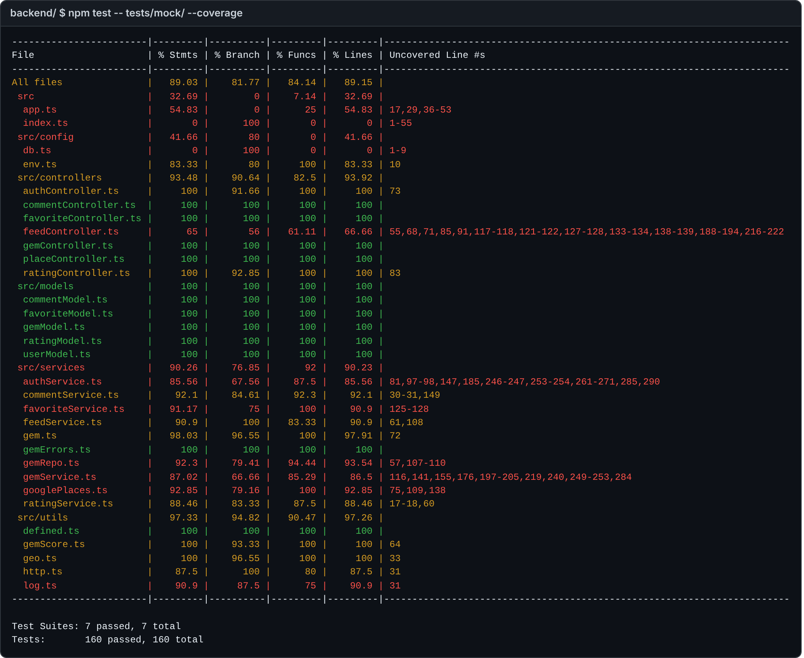
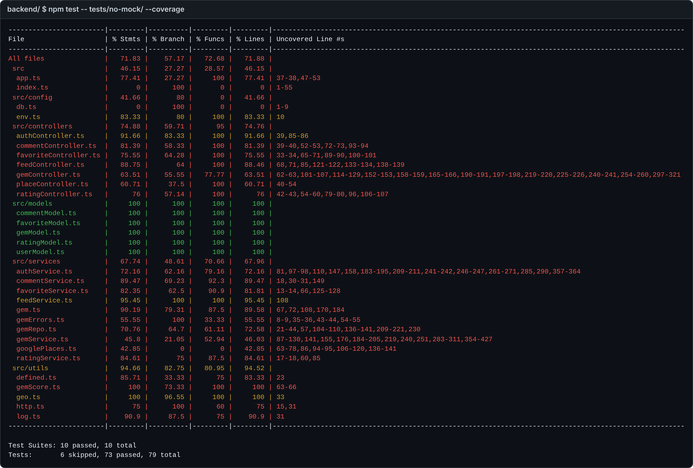
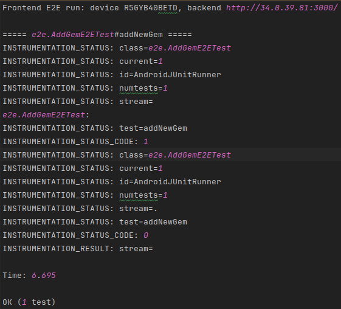
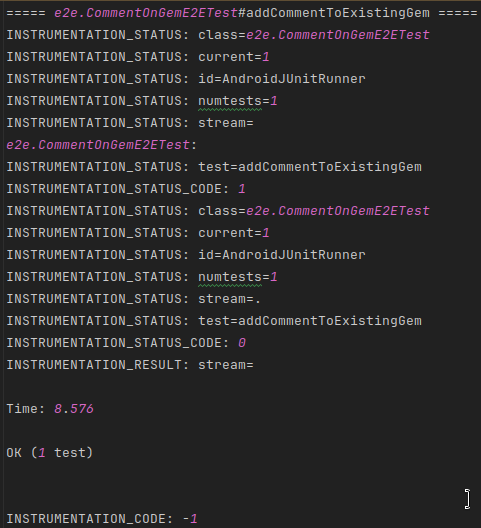
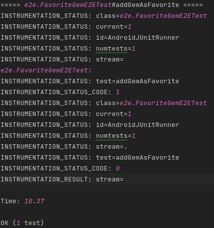
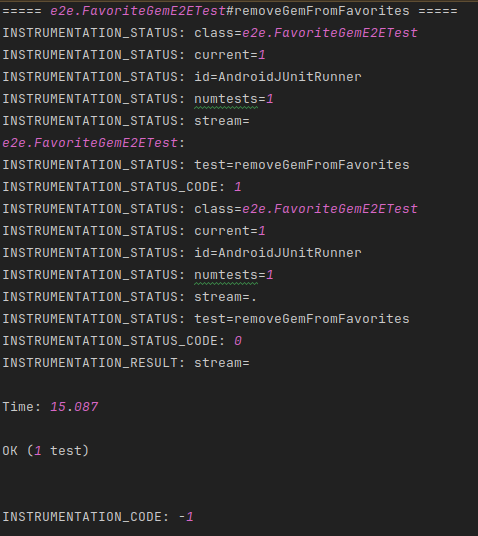

# Testing

## 1. Change History

| **Change Date**   | **Modified Sections** | **Rationale** |
| ----------------- | --------------------- | ------------- |
| 2026-10-31 | 2.1, 2.2, 2.5 | Listed every backend interface's test groups, how to run them, and the CI workflow. |
| 2026-10-31 | 3 | Added the two non-functional requirement tests and how they verify the requirements. |
| 2026-11-03 | 2.3, 2.4, 2.5 | Added the coverage of the mocked, unmocked and combined interface tests, and why the remaining lines are not covered. Coverage now maps to the TypeScript source lines (source maps enabled for the tests). |
| 2026-11-17 | 2.1 | Added the tests of `GET /gem/:pk/photo`; updated the gem test locations. |
| 2026-11-18 | 2.1 | `POST /user/favorites` tests expect the whole gem; updated the favorites test locations. |
| 2026-11-18 | 2.1, 2.4 | Added a test of two users rating a gem at once (`PUT /gem/:pk/rating`, found in peer review); updated the rating test locations and the uncovered line in `ratingService.ts`. |
| 2026-11-18 | 2.1.2, 2.3, 2.4, 2.5, 3.2 | Re-ran every backend test on the current code: new coverage screenshots and numbers, uncovered lines updated after `gemService.ts` was split into five files, two new mocked tests of `GET /gem/:pk/photo` for Google failing while it looks up or searches for the photo (those lines were not covered before), and new non-functional requirement logs. |
| 2026-11-18 | 4.1, 4.2 | Replaced the template with the front-end end-to-end tests: where they are, how to run them, and the expected behaviours of Add a Gem, Make comments, Mark a Gem as favorite and Remove a favorite. |

---

## 2. Back-end Test Specification: APIs

### 2.1. Locations of Back-end Tests and Instructions to Run Them

#### 2.1.1. Tests

Every interface has one `describe` group without mocks (real app, real in-memory MongoDB) and one with mocks (database, Google and the login check's user lookup replaced to force errors and edge cases). Each test is annotated with its input, expected status code, expected behavior, expected output and, for mocked tests, what the mock does. Unit tests of the services and of the GemScore and distance calculations are in `backend/tests/unit/`.

The no-mock tests that call the real Google Places API (marked "with Google Places") run only when `GOOGLE_API_KEY` is set; without it they are skipped, and the same behavior is covered with Google mocked.

| **Interface** | **Describe Group Location, No Mocks** | **Describe Group Location, With Mocks** | **Mocked Components** |
| --- | --- | --- | --- |
| **GET /gem** | [`tests/no-mock/gem.test.ts#L24`](../backend/tests/no-mock/gem.test.ts#L24) | [`tests/mock/gem.test.ts#L65`](../backend/tests/mock/gem.test.ts#L65) | gems collection |
| **POST /gem** | [`tests/no-mock/gem.test.ts#L68`](../backend/tests/no-mock/gem.test.ts#L68), [`tests/no-mock/gem.test.ts#L120`](../backend/tests/no-mock/gem.test.ts#L120) | [`tests/mock/gem.test.ts#L195`](../backend/tests/mock/gem.test.ts#L195), [`tests/mock/gem.test.ts#L311`](../backend/tests/mock/gem.test.ts#L311), [`tests/mock/gem.test.ts#L349`](../backend/tests/mock/gem.test.ts#L349) | gems collection, users collection (login check), Google Places API |
| **GET /gem/nearby** | [`tests/no-mock/gem.test.ts#L162`](../backend/tests/no-mock/gem.test.ts#L162) | [`tests/mock/gem.test.ts#L411`](../backend/tests/mock/gem.test.ts#L411) | gems collection |
| **GET /gem/within** | [`tests/no-mock/gem.test.ts#L219`](../backend/tests/no-mock/gem.test.ts#L219) | [`tests/mock/gem.test.ts#L483`](../backend/tests/mock/gem.test.ts#L483) | gems collection |
| **GET /gem/newest** | [`tests/no-mock/gem.test.ts#L262`](../backend/tests/no-mock/gem.test.ts#L262) | [`tests/mock/gem.test.ts#L536`](../backend/tests/mock/gem.test.ts#L536) | gems collection |
| **GET /gem/:pk/photo** | [`tests/no-mock/gem.test.ts#L318`](../backend/tests/no-mock/gem.test.ts#L318), [`tests/no-mock/gem.test.ts#L348`](../backend/tests/no-mock/gem.test.ts#L348) | [`tests/mock/gem.test.ts#L617`](../backend/tests/mock/gem.test.ts#L617) | gems collection, Google Places API |
| **GET /gem/:pk/comments** | [`tests/no-mock/comment.test.ts#L68`](../backend/tests/no-mock/comment.test.ts#L68) | [`tests/mock/comment.test.ts#L51`](../backend/tests/mock/comment.test.ts#L51) | comments collection, gems collection |
| **POST /gem/:pk/comments** | [`tests/no-mock/comment.test.ts#L17`](../backend/tests/no-mock/comment.test.ts#L17) | [`tests/mock/comment.test.ts#L150`](../backend/tests/mock/comment.test.ts#L150) | comments collection, gems collection, users collection (login check) |
| **PUT /gem/:pk/rating** | [`tests/no-mock/rating.test.ts#L21`](../backend/tests/no-mock/rating.test.ts#L21) | [`tests/mock/rating.test.ts#L56`](../backend/tests/mock/rating.test.ts#L56) | ratings collection, gems collection, users collection (login check), Live Feed |
| **GET /gem/:pk/rating** | [`tests/no-mock/rating.test.ts#L121`](../backend/tests/no-mock/rating.test.ts#L121) | [`tests/mock/rating.test.ts#L162`](../backend/tests/mock/rating.test.ts#L162) | ratings collection, gems collection, users collection (login check) |
| **GET /place/nearby** | [`tests/no-mock/place.test.ts#L11`](../backend/tests/no-mock/place.test.ts#L11), [`tests/no-mock/place.test.ts#L34`](../backend/tests/no-mock/place.test.ts#L34) | [`tests/mock/place.test.ts#L40`](../backend/tests/mock/place.test.ts#L40) | Google Places API, gems collection |
| **POST /user/auth/google** | [`tests/no-mock/auth.test.ts#L15`](../backend/tests/no-mock/auth.test.ts#L15) | [`tests/mock/auth.test.ts#L35`](../backend/tests/mock/auth.test.ts#L35) | Google Sign-In, users collection |
| **Login check (`reqJwt`, all routes requiring login)** | [`tests/no-mock/auth.test.ts#L47`](../backend/tests/no-mock/auth.test.ts#L47) | [`tests/mock/auth.test.ts#L119`](../backend/tests/mock/auth.test.ts#L119) | users collection |
| **GET /user/me** | [`tests/no-mock/profile.test.ts#L16`](../backend/tests/no-mock/profile.test.ts#L16) | [`tests/mock/auth.test.ts#L119`](../backend/tests/mock/auth.test.ts#L119) | users collection |
| **GET /user/favorites** | [`tests/no-mock/favorite.test.ts#L78`](../backend/tests/no-mock/favorite.test.ts#L78) | [`tests/mock/favorite.test.ts#L61`](../backend/tests/mock/favorite.test.ts#L61) | favorites collection, gems collection, users collection (login check) |
| **POST /user/favorites** | [`tests/no-mock/favorite.test.ts#L25`](../backend/tests/no-mock/favorite.test.ts#L25) | [`tests/mock/favorite.test.ts#L121`](../backend/tests/mock/favorite.test.ts#L121) | favorites collection, gems collection, users collection (login check) |
| **DELETE /user/favorites/:placeId** | [`tests/no-mock/favorite.test.ts#L111`](../backend/tests/no-mock/favorite.test.ts#L111) | [`tests/mock/favorite.test.ts#L218`](../backend/tests/mock/favorite.test.ts#L218) | favorites collection, users collection (login check) |
| **WebSocket /feed** | [`tests/no-mock/feed.test.ts#L40`](../backend/tests/no-mock/feed.test.ts#L40) | [`tests/mock/feed.test.ts#L73`](../backend/tests/mock/feed.test.ts#L73) | gems collection, users collection, Google Places API (gems are added through POST /gem) |

#### 2.1.2. Commit Hash Where Tests Run

`[MAIN COMMIT SHA AFTER THE FINAL MERGE]`

#### 2.1.3. Explanation on How to Run the Tests

1. **Clone the repository and install the backend's dependencies** (Node.js 22):
   ```
   git clone https://github.com/ubc-cpen-321-excavator/excavator.git
   cd excavator/backend
   npm install
   ```
2. **Run the interface tests** (with mocks, without mocks, then both together, each with a coverage report in `backend/coverage/`):
   ```
   cd ..
   ./scripts/run-backend-interface-tests.sh
   ```
   Or all backend tests at once from `backend/`: `npm test`. The tests need no `.env` file and no running database: the no-mock tests start their own MongoDB in memory (downloaded once on the first run, which takes about a minute) and use a test JWT secret.
3. **Optional, to include the tests that call the real Google Places API:** set `GOOGLE_API_KEY` to a key with Places API (New) enabled, e.g. `GOOGLE_API_KEY=... npm test`.

### 2.2. GitHub Actions Configuration Location

`.github/workflows/backend-tests.yml` — runs the typecheck, the interface tests (mock, no-mock, combined, with coverage), the non-functional requirement tests and the unit tests on every push to `main` and on pull requests into `main` and `develop`. The coverage reports are kept as a downloadable artifact of each run.

### 2.3. Jest Coverage Report Screenshots With Mocks

`tests/mock/` only: 89.2% of lines, 81.8% of branches (160 tests).



### 2.4. Jest Coverage Report Screenshots Without Mocks

`tests/no-mock/` only: 71.9% of lines, 57.2% of branches (73 tests; the 6 that call the real Google Places API are skipped without a key). Lower than with mocks because database and Google failures can only be produced with mocks.



### 2.5. Jest Coverage Report Screenshots With and Without Mocks Combined

`tests/mock/` and `tests/no-mock/` together: 91.9% of lines, 84.5% of branches (233 tests). All five models are at 100%, and all seven controllers except the Live Feed are at 100% of lines. The backend's unit tests (`tests/unit/`, not part of these interface runs) cover most of the remaining lines: with them, the whole suite (478 tests) reaches 96.1% of lines and 93.8% of branches, and only the lines marked "not covered by any test" below remain.

**Why the remaining lines are not covered by the interface tests** (line numbers from the combined run above):

| File | Lines | Why not covered |
| ---- | ----- | --------------- |
| `src/index.ts` | all | Starts the real server: listens on `PORT`, connects to the production MongoDB and handles `SIGINT`/`SIGTERM`. The tests import the app from `createApp()` in `app.ts` instead, so every route is still tested without opening a port or a real database. |
| `src/config/db.ts` | all | Connects to `MONGODB_URI`; only called by `index.ts`. The no-mock tests connect Mongoose to an in-memory MongoDB in `tests/helpers/db.ts`. |
| `src/config/env.ts` | 10 | Throws when `PORT` is not a valid port. It runs once when the module loads, so testing it would stop the test process. |
| `src/app.ts` | 37–38, 47–53 | The app-wide error handler's fallbacks. Every route catches its own errors and answers itself, so these only run for errors Express raises other than malformed JSON (which is tested in `tests/no-mock/errors.test.ts`), or for a response that was already started. |
| `src/utils/http.ts` | 31 | Passes a rejected `async` handler to Express. No handler rejects: each catches its own errors. |
| `src/utils/log.ts` | 31 | `logInfo`, only used by `index.ts` at start-up. |
| `src/controllers/feedController.ts` | 68, 71, 85, 121–122, 133–134, 138–139 | Lines 68 and 71 decode WebSocket messages delivered as an array of Buffers or an ArrayBuffer; `ws` delivers a single Buffer with our settings. Lines 85–139 reject binary messages, unknown message types, invalid radii and too-frequent subscriptions; the interface tests cover invalid JSON and locations, and these four cases are covered by the unit tests of `handleFeedMessage` in `tests/unit/feedMessage.test.ts`. |
| `src/services/gemService.ts` | 116, 141, 155, 176, 284 | The service's own input checks, which the controllers already make: the routes answer 400 before calling the service, so these can't be reached through the API. They are kept so the service is safe when called from other code. Covered by `tests/unit/gemService.test.ts`, except 116 and 155, which are not covered by any test: their only callers (`addGem` for 116; comments, ratings and favorites for 155) always check the name first. |
| `src/services/gemService.ts` | 197–205 | `scoreGem`, which no route calls: gems are scored when added and when rated. Covered by the unit tests. |
| `src/services/gemService.ts` | 219, 240, 251 | A gem deleted while it is being rated, which the API can't produce on demand. 219 and 240 are covered by the unit tests; 251 (the gem deleted between saving its new totals and reading it back) is not covered by any test. |
| `src/services/gem.ts` | 72 | `parsePlaceTypes` rejecting a `type` that is not a string. Express only gives the route strings or lists of strings, so this can't come from a request. Covered by the unit tests. |
| `src/services/gemRepo.ts` | 57, 107–110 | A stored gem without coordinates (57; the schema requires them, so not covered by any test), and two users adding the same gem at the same instant (107–110; covered by the unit tests). |
| `src/services/googlePlaces.ts` | 75, 109, 138 | Google returning a place without a name or location, which the API can't produce on demand. Covered by the unit tests with mocked Google responses. |
| `src/services/authService.ts` | 81, 97–98, 147, 185, 246–247, 261–271, 285, 290 | Guards the API can't reach: `currentUser` before `reqJwt` (81, a programming error), `JWT_SECRET` missing (147; the tests set it), a Google token without an account ID (185), a valid token without a user ID (246–247; the server never issues one), a database failure during the login check (261–262), `getUser`, which no route calls (266–271), and an invalid profile update or a user deleted mid-request in the service (97–98, 285, 290; the route checks first). All are covered by `tests/unit/authService.test.ts`. |
| `src/services/commentService.ts`, `ratingService.ts` | 30–31, 149; 17–18, 60 | The services' own body and star checks and their error classes; the routes reject invalid input with 400 first. Covered by the unit tests. |
| `src/services/favoriteService.ts` | 125–128 | Two requests adding the same favorite at the same instant (duplicate-key error). Covered by the unit tests. |
| `src/services/feedService.ts` | 108 | Drops a client whose socket throws while sending, which a real socket in the tests doesn't do. Covered by the unit tests. |

Branch-only gaps (lines that run, with one side of a condition never taken) are of the same kinds: `req.body ?? {}` when a request has no JSON body (`authController.ts` 73, `ratingController.ts` 83), a Gem Score input without an Excavator average (`gemScore.ts` 64) or a non-finite number (`geo.ts` 33), which the routes reject first, and optional fields Google or MongoDB always return in the tests.

---

## 3. Tests of Non-Functional Requirements

### 3.1. Test Locations in Git

| **Non-Functional Requirement** | **Location in Git** |
| --- | --- |
| **Live updates arrive within 1 second** | [`backend/tests/nfr/feedLatency.test.ts`](../backend/tests/nfr/feedLatency.test.ts) |
| **The map stays fast with many gems** | [`backend/tests/nfr/mapQueryTime.test.ts`](../backend/tests/nfr/mapQueryTime.test.ts) |

Run them with `./scripts/run-backend-nfr-tests.sh`, or `npm test -- tests/nfr/` from `backend/`. Like the no-mock tests, they start their own in-memory MongoDB.

### 3.2. Test Verification and Logs

- **Live updates arrive within 1 second**

  - **Verification:** The test starts the real server with its real WebSocket feed and a real in-memory MongoDB, then connects 250 WebSocket clients: 200 subscribed 5 km around UBC and 50 around Toronto. It adds a gem at UBC through `POST /gem` (signed in, as the app does) and records when each client receives it, measured from the moment the request is sent; it then rates the gem through `PUT /gem/:pk/rating` and measures the `gem.updated` messages the same way. The requirement is met when all 200 UBC clients receive each update, the slowest within 1000 ms, the update carries the new data (the rescored gem), and none of the Toronto clients receive anything. Only Google Places is mocked, since its response time is Google's rather than ours. The test logs the median and maximum latency of each run.
  - **Log Output**
    ```
    $ npx jest tests/nfr   (2026-11-18, Linux, 2 vCPUs, Node 22)
     PASS  tests/nfr/feedLatency.test.ts
      [NFR1] gem.added: 200 clients, median 36 ms, max 38 ms (limit 1000 ms)
      [NFR1] gem.updated: 200 clients, median 26 ms, max 28 ms (limit 1000 ms)
    ```
    Every one of the 200 nearby clients received both updates, the slowest within 38 ms, and none of the 50 far-away clients received anything, so the requirement is met with a wide margin.

- **The map stays fast with many gems**
  - **Verification:** The test stores 10,000 gems spread over Metro Vancouver (generated from a fixed seed, so every run uses the same data) in a real in-memory MongoDB with the app's indexes, then times 50 requests to `GET /gem/within`, over map areas from neighbourhood size (about 1 km) to city size (about 20 km), and 50 requests to `GET /gem/nearby` with a 5 km radius at random points, all with the app's maximum page size of 50. Each request goes through the full app (routing, validation, query, JSON). The requirement is met when the 95th-percentile response time of each query type is under 500 ms; nothing is mocked. The test logs the median, 95th-percentile and maximum response times.
  - **Log Output**
    ```
    $ npx jest tests/nfr   (2026-11-18, Linux, 2 vCPUs, Node 22)
     PASS  tests/nfr/mapQueryTime.test.ts
      [NFR2] GET /gem/within: 50 requests on 10000 Gems, median 8.6 ms, p95 14.3 ms, max 31.2 ms (limit p95 500 ms)
      [NFR2] GET /gem/nearby: 50 requests on 10000 Gems, median 5.1 ms, p95 9.5 ms, max 21.3 ms (limit p95 500 ms)
    ```
    Both query types answer far under the 500 ms limit at the 95th percentile, so the requirement is met with a wide margin.

---

## 4. Front-end Test Specification

### 4.1. Location in Git of Front-end Test Suite:

`frontend/app/src/androidTest/e2e/`

| **File** | **Contents** |
| -------- | ------------ |
| [`AddGemE2ETest.kt`](../frontend/app/src/androidTest/e2e/AddGemE2ETest.kt) | Use Case 1: Add a Gem. |
| [`CommentOnGemE2ETest.kt`](../frontend/app/src/androidTest/e2e/CommentOnGemE2ETest.kt) | Use Case 5: Make comments. |
| [`FavoriteGemE2ETest.kt`](../frontend/app/src/androidTest/e2e/FavoriteGemE2ETest.kt) | Mark a Gem as favorite, and Remove a favorite. |
| [`E2ETestBase.kt`](../frontend/app/src/androidTest/e2e/E2ETestBase.kt) | Setup shared by every test (location on, location permission granted, app opened on the Dashboard) and the UI helpers (waiting for elements, opening and expanding a gem's info sheet, reading the star's colour). |
| [`BackendClient.kt`](../frontend/app/src/androidTest/e2e/BackendClient.kt) | Calls the backend as the signed-in user. Only used to set up and clean up the favorites tests, never to check a result. |

`frontend/app/build.gradle.kts` adds `src/androidTest/e2e` to the `androidTest` source set. The tests use the Compose UI test framework with UI Automator, and find elements by the test tags in `TestTags`.

The tests run the real app against the real backend, with no mocks, as the user who is signed in on the device. The tests never sign in themselves.

**How to run the tests:**

1. Connect a phone (USB debugging on) or start an emulator. If several are connected, set `ANDROID_SERIAL`.
2. Set `API_BASE_URL` in `frontend/local.properties` to the backend. If it is `10.0.2.2`, `localhost` or `127.0.0.1`, the script starts the local backend (`scripts/run-backend.sh`, which needs Docker and `backend/.env`); set `E2E_START_BACKEND=yes|no` to override. `10.0.2.2` only works on an emulator.
3. Run the script from the repository root, on the computer whose debug key Google Sign-In trusts (the script builds and installs both the app and the test APK):
   - macOS/Linux: `./scripts/run-frontend-e2e-tests.sh`
   - Windows: `.\scripts\run-frontend-e2e-tests.ps1`
4. Sign in to the app on the device when asked. The script waits up to `E2E_SIGNIN_TIMEOUT` seconds (default 300).

The script runs each test in its own instrumentation process, prints a pass/fail table, saves the full log in `frontend/app/build/e2e-logs/`, and exits non-zero unless every test passed. It never uninstalls the app or clears its data.

**Data the tests need on the device:**

- *Add a Gem*: the device needs a location fix with at least one place within 200 m that is not a gem yet. Gems can't be deleted, so each run leaves one new gem behind.
- *Make comments*: the Dashboard must list at least one gem. Comments can't be deleted, so each run leaves one comment starting with "UI test comment".
- *Favorites*: the Dashboard must list at least one gem. The newest gem is removed from the user's favorites through the backend before and after each test, so its star starts grey and no favorite is left behind.

### 4.2. Tests

- **Use Case: Add a Gem (Use Case 1)**

  - **Test:** `AddGemE2ETest.addNewGem`
  - **Expected Behaviors:**

    | **Scenario Steps** | **Test Case Steps** |
    | ------------------ | ------------------- |
    | 1. The User taps "Add gem" on the Discovery screen. | Open the app on the Dashboard.<br>Tap "Discovery" in the navigation bar.<br>Tap the "Add gem" button (`ADD_GEM_BUTTON`).<br>Check that the "Add New Gem" sheet is displayed. |
    | 2. The app gets the User's location, asking for location permission if it hasn't been granted. | Before the test, switch on the device's location and grant the app `ACCESS_FINE_LOCATION` and `ACCESS_COARSE_LOCATION`, so no system dialog covers the app. |
    | 3. The User optionally selects type filters (e.g. café, park). | Select no filter.<br>Tap "Submit" (`SUBMIT_BUTTON`). |
    | 4. The app lists the places within 200 m of the User that aren't gems yet, nearest first. | Check that at least one place card (`CANDIDATE_CARD`) is displayed within 30 s.<br>Read the name of the first place. |
    | 5. The User picks a place and confirms adding it. | Tap the first place card.<br>Check that the list of places closes. |
    | 6. The app shows the new gem, with its Gem Score, on the map. | Tap "Dashboard" in the navigation bar.<br>Check that "Latest Gems:" is displayed.<br>Check that the first gem card (`GEM_CARD`) under "Latest Gems:" has the name of the picked place. |

  - **Test Logs:**
  - 


- **Use Case: Make comments (Use Case 5)**

  - **Test:** `CommentOnGemE2ETest.addCommentToExistingGem`
  - **Expected Behaviors:**

    | **Scenario Steps** | **Test Case Steps** |
    | ------------------ | ------------------- |
    | 1. The User opens a gem (Use Case 2) and opens its comments. | Open the app on the Dashboard.<br>Check that "Latest Gems:" is displayed.<br>Tap the first gem card (`GEM_CARD`).<br>Check that the gem's info sheet opens on the Discovery map, showing the gem's title and the favorite star.<br>Drag the sheet's handle to the top of the screen.<br>Check that the sheet is fully expanded (its handle now offers "collapse"). |
    | 2. The app shows the gem's comments, oldest first. | Check that the new comment field (`COMMENT_INPUT`) is displayed. |
    | 3. The User types a comment and taps "Post". | Type "UI test comment &lt;current time in ms&gt;" in the comment field.<br>Check that the field holds the typed comment.<br>Tap "Send Comment" (`SEND_COMMENT_BUTTON`). |
    | 4. The app adds the comment at the bottom of the list, with the User's name. | Check that the comment field is cleared.<br>Scroll the comment list to a comment body (`COMMENT_BODY`) with the typed text.<br>Check that the comment is displayed. |

  - **Test Logs:**
  - 


- **Use Case: Mark a Gem as favorite**

  - **Test:** `FavoriteGemE2ETest.addGemAsFavorite`
  - **Expected Behaviors:**

    | **Scenario Steps** | **Test Case Steps** |
    | ------------------ | ------------------- |
    | 1. The User opens a gem that is not a favorite. | Before the test, get the newest gem from the backend (`GET /gem/newest`) and remove it from the user's favorites (`DELETE /user/favorites/:placeId`).<br>Open the app on the Dashboard.<br>Scroll the "Latest Gems:" grid to the gem's card and tap it.<br>Check that the gem's info sheet opens, and fully expand it.<br>Check that the star is grey. |
    | 2. The User taps "favorite" on the gem. | Tap the star.<br>Check that the star turns yellow. |
    | 3. The gem is in the User's favorites. | Close the info sheet with the Back button.<br>Tap "Favorites" in the navigation bar.<br>Check that "Your favorites:" is displayed.<br>Check that the gem's card, with the ★ badge, is displayed.<br>After the test, remove the gem from the user's favorites through the backend. |

  - **Test Logs:**
  - 


- **Use Case: Remove a favorite**

  - **Test:** `FavoriteGemE2ETest.removeGemFromFavorites`
  - **Expected Behaviors:**

    | **Scenario Steps** | **Test Case Steps** |
    | ------------------ | ------------------- |
    | 1. The User has a gem in their favorites. | Make the newest gem a favorite through the UI, with the same steps as `addGemAsFavorite`. |
    | 2. The User opens the gem. | Tap "Dashboard" in the navigation bar.<br>Tap the gem's card and fully expand its info sheet.<br>Check that the star is yellow. |
    | 3. The User removes the gem from their favorites. | Tap the star.<br>Check that the star turns grey. |
    | 4. The gem is no longer in the User's favorites. | Close the info sheet with the Back button.<br>Tap "Favorites" in the navigation bar.<br>Check that "Your favorites:" is displayed.<br>Check that the gem's card is no longer displayed.<br>After the test, remove the gem from the user's favorites through the backend (does nothing if it is not one). |

  - **Test Logs:**
  - 

